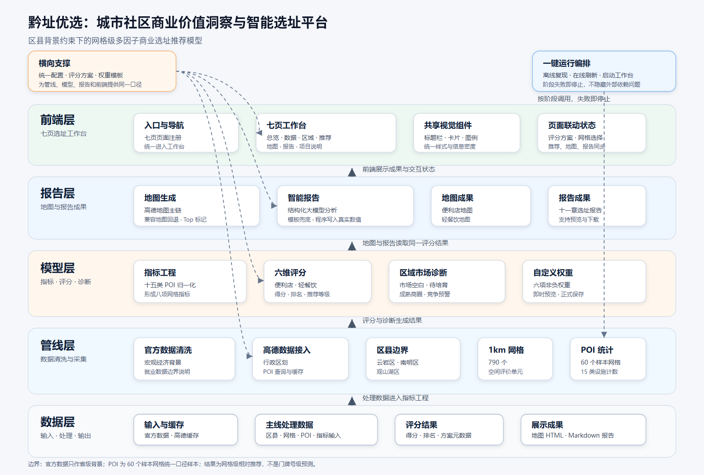

# 黔址优选：城市社区商业价值洞察与智能选址平台架构说明

> 项目名称：黔址优选：城市社区商业价值洞察与智能选址平台  
> 项目方向：公共数据赛道 / 社区商业智能选址  
> 架构版本：v2 当前主线  
> 提交材料类型：架构说明  
> 编制日期：2026 年 6 月 17 日  

## 一、文档目的

本文用于说明“黔址优选：城市社区商业价值洞察与智能选址平台”v2 原型系统的整体技术架构、数据链路、模型能力、报告生成方式、前端工作台组成和运行边界。文档面向比赛评审、技术答辩和后续试点沟通，重点回答三个问题：

1. 系统如何把公共数据和位置服务数据组织成可复现的选址分析链路。
2. 模型如何从 POI 样本、空间网格和多因子指标中形成推荐、诊断和解释。
3. 前端如何把评分、地图和智能报告整合为可演示、可交互、可扩展的决策工作台。

系统采用五层架构：数据层、管线层、模型层、报告层和前端层。五层之间保持相对清晰的职责边界：数据层保留真实输入和中间结果，管线层负责标准化处理，模型层负责指标、评分和诊断，报告层负责地图与文本解释，前端层负责交互展示和用户操作。

## 二、总体架构图



该图按照项目当前 v2 主线绘制，不包含本机绝对路径，不展示密钥，不把旧版 OSM/两阶段路线作为当前主链。图中的“官方公共数据”“高德区划边界”“高德 POI 样本”和“1km 评价网格”共同构成数据基础；后续管线、模型、地图、报告和工作台均围绕同一套网格标识和评分方案运行。

## 三、设计原则

### 3.1 数据真实优先

项目不使用手工编造的门店、客流、租金或经营数据。当前 v2 主线使用真实存在的官方处理数据、高德行政区划边界、高德 POI 样本、真实生成的 1km 评价网格和实际评分结果。外部数据能力不足时，系统在文档、报告和页面中明确边界，不把缺失能力包装成已实现能力。

### 3.2 网格级评价优先

系统不把区县作为最终推荐对象。区县只承担背景约束和空间范围作用，真正参与评价的是 1km 空间网格。这样既避免区县平均值过粗，也避免在没有门店租赁、真实客流和现场调研数据的情况下过度细化到门牌号级。

### 3.3 可解释推荐优先

推荐结果不仅给出综合分和排名，还给出交通可达性、消费潜力、就业客群代理、共生业态、低竞争得分和商业氛围等六维指标，并同步生成主要优势、主要风险、市场阶段和竞争预警。系统强调“为什么推荐”和“风险在哪里”，而不是只输出一个排名。

### 3.4 默认离线复现

默认一键流程使用已经形成的真实 60 个 POI 样本网格数据，离线重建指标、评分、地图和模板报告。重新调用高德接口、调用 DeepSeek 生成报告、启动工作台等动作均由用户显式启用，避免默认流程被网络、额度或密钥状态阻断。

## 四、数据层

数据层承载系统的原始输入、处理后数据和运行结果，是整套系统的可信基础。

| 数据类型 | 当前用途 | 边界 |
|---|---|---|
| 官方公共数据 | 说明贵州省级市场背景 | 不拆分到区县或网格 |
| 高德行政区划 | 获取三区边界、中心点和空间约束 | 街道级不作为评分对象 |
| 高德 POI 样本 | 形成 15 类设施统计和网格指标 | 不解释为完整设施总量 |
| 1km 空间网格 | 承载评分、排名、地图和报告 | 不等同于具体铺位 |
| 评分与报告输出 | 支撑工作台展示和交付材料 | 可由一键流程复现 |

高德行政区域查询文档明确说明，街道级请求不能返回边界数据，乡镇街道级行政编码也与所属区县一致。[^5] 因此本项目不把街道边界作为评分对象，而是在区县边界内构建统一的 1km 网格。

高德 POI 2.0 搜索服务支持关键字、分类编码、周边搜索和多边形搜索，但同一请求参数的翻页结果存在数量限制，且接口不等同于全量设施数据库。[^6] 当前系统采用统一关键词口径，对 60 个空间分散网格采集 15 类 POI，用于原型验证和相对比较。

## 五、管线层

管线层负责把多源输入转换为可被模型层稳定消费的结构化表格和空间对象。

| 模块 | 主要职责 |
|---|---|
| 配置管理 | 统一项目名称、目标城市、区县、网格尺寸、POI 类别、评分模板、地图和大模型配置 |
| 高德客户端 | 封装行政区划查询、周边 POI 查询、多边形 POI 查询和本地缓存 |
| 区县边界构建 | 在线获取三区基础信息和区县边界 |
| 网格生成 | 在统一投影坐标系中生成 1000m 网格并按区县边界裁剪 |
| POI 采集统计 | 对每区 20 个样本网格采集 15 类 POI 并输出明细和统计 |
| 一键运行 | 串联离线复现流程，按需启用高德刷新、DeepSeek 和工作台启动 |

关键输出采用临时文件写入后替换的方式，失败时不覆盖已有完整结果。输入文件缺失、字段缺失、区县不一致、网格无法匹配等情况会明确报错，不读取其他相似文件代替。

## 六、模型层

模型层负责把 POI 统计和网格属性转换为可比较、可解释、可筛选的选址结果。

### 6.1 指标工程

指标工程以 60 个已采集 POI 样本网格为有效样本，不为未采集网格填零。每类 POI 计数先经过 `log1p` 缩放，再在全市样本网格范围内做 0-100 Min-Max 归一化。常量字段统一归零，表示该字段无法区分网格。

当前指标包括交通可达性、消费潜力、就业客群代理、商业氛围、便利店共生业态、轻餐饮共生业态、便利店竞争压力和轻餐饮竞争压力。

### 6.2 通用评分模型

评分模型支持默认方案和自定义方案。默认方案包括社区便利店和轻餐饮，二者使用相同六维框架，但采用不同的共生字段、竞争字段和均衡差异化权重。竞争压力在综合评分中以“低竞争得分”形式参与计算。

用户自定义方案可以选择社区零售型或餐饮服务型模板，并设置六项非负权重。权重合计归一为 1 后传入后端评分接口，即时生成新的综合分、排名、优势、风险和推荐等级。正式保存后，自定义方案可被地图和报告模块发现。

### 6.3 市场诊断模型

区域市场诊断模块基于全市有 POI 活动的网格计算三分位阈值，把网格划分为市场空白型、待培育型、成熟商圈型和一般观察型，并独立标记过度竞争预警。

诊断只改变解释和筛选，不改变综合得分、权重、排名和推荐等级。市场空白不代表保证盈利，过度竞争预警不代表企业真实经营状况，需求客群代理也不等于真实客流。

## 七、报告层

报告层把模型层的结构化结果转换为可阅读、可展示、可交付的地图和文本报告。

### 7.1 地图洞察

地图模块以高德 JS API 为主链，直接使用 GCJ-02 网格和中心点数据。缺少 JS API 凭据时，系统可以回退到兼容地图方式。

地图展示 790 个空间网格的覆盖状态：未采集网格、无 POI 活动网格、有评分网格和全局 Top 10 编号标记。悬停和点击详情中展示网格、区县、得分、排名、推荐等级、主要优势、主要风险、市场阶段和竞争预警。

### 7.2 智能报告

报告模块支持模板报告和 DeepSeek 智能报告。默认优先使用 `deepseek-v4-pro`，仅在连接、超时、限流、服务端错误或模型不可用等临时性问题下回退到 `deepseek-v4-flash`。鉴权、余额、参数、输入字段错误和结构化校验失败不会用轻量模型掩盖。

报告固定包含 11 个章节：评价网格基本信息、适配业态与推荐等级、交通可达性分析、消费潜力分析、就业/办公客群代理分析、共生业态分析、竞争压力分析、商业氛围与权重方案、主要优势与风险、经营建议、数据来源与限制说明。

报告只解释系统已有字段，不自行发明真实租金、客流、营收、盈利或门牌号级结论。若大模型不可用，页面明确显示失败原因并提供模板报告按钮。

## 八、前端层

前端层使用 Streamlit 构建七页工作台。

| 页面 | 主要职责 |
|---|---|
| 项目总览 | 展示目标区县、空间网格、POI 类别、活跃推荐网格、主题 POI 摘要和区县平均得分 |
| 数据底座 | 展示真实数据资产、记录数、地域范围、数据角色和坐标说明 |
| 区域对比 | 展示三区 POI 原始数量、活跃网格平均分和区县对比 |
| 网格推荐 | 承载默认方案、自定义权重、即时评分、全部排名、六维分解和区域诊断筛选 |
| 地图洞察 | 展示高德地图、评分覆盖层、Top 标记、数据覆盖状态和自定义方案 |
| 智能报告 | 选择评分方案和评价网格，点击后生成结构化报告，支持模板兜底 |
| 项目说明 | 展示项目边界、数据限制、方法说明和当前能力 |

前端不直接改写模型公式。自定义权重页面会构造评分方案对象并调用后端评分接口；地图和报告页面读取已经保存的评分方案元数据，保证各模块使用同一套结果口径。

## 九、端到端运行流程

默认流程不调用高德接口，不调用 DeepSeek，不启动工作台。执行后会重建指标、默认评分、地图和模板报告，并输出运行摘要。

```powershell
python scripts/run_pipeline.py
```

需要刷新区县边界、网格和 POI 样本时，显式启用高德刷新流程：

```powershell
python scripts/run_pipeline.py --refresh-amap
```

需要调用 DeepSeek 生成正式智能报告时，显式启用大模型参数或在前端点击生成按钮：

```powershell
python scripts/run_pipeline.py --with-llm
```

工作台通过固定入口启动：

```powershell
streamlit run src/app.py
```

## 十、外部依赖与安全边界

系统涉及三类外部能力：高德 Web 服务、高德 JS API 和 DeepSeek API。三类能力均通过环境变量读取凭据，不写入源码、配置文件、Markdown 文档或运行日志。默认离线流程不依赖这些外部服务。

系统输出的是统一数据口径下的相对评价。当前不包含运营商信令、真实移动互联网定位、门店合同、租金、转化率、营收和利润数据，因此不输出绝对客流、绝对盈利或具体门牌号级铺位推荐。

高德来源数据使用 GCJ-02 坐标。高德地图主链直接使用 GCJ-02 展示；兼容地图路径才在渲染阶段进行坐标转换。系统不在数据层声称完成 GCJ-02 与 WGS84 的权威坐标转换。

## 十一、可扩展方向

后续可以接入租金、真实客流、门店经营、人口年龄结构、消费水平、道路通达性和竞品品牌数据。新增数据必须先明确来源、粒度、时间范围和合法使用边界，再进入指标工程。

当前默认支持社区便利店和轻餐饮，并支持用户自定义权重。若要新增银行网点、药店、社区服务站等正式业态，应补充对应 POI 类别、共生关系、竞争压力和业务解释模板，而不是简单复制现有权重。

当前系统适合本机演示和比赛答辩。若后续部署到公网，应增加服务端密钥代理、访问控制、日志脱敏、任务队列、缓存清理策略和用户权限管理。

## 十二、参考资料

[^1]: 科技日报：《[2026年贵州省人工智能创业大赛正式启动](https://www.stdaily.com/web/gdxw/2026-04/24/content_507832.html)》，2026-04-24。
[^2]: 上海电力大学：《[“智启黔程・创享未来”贵州省人工智能创业大赛宣讲会在我校举行](https://www.shiep.edu.cn/3e/f9/c3154a278265/page.htm)》，2026-06-11。
[^3]: 新华网：《[聚焦服务业扩能提质丨我国稳步推进一刻钟便民生活圈建设](https://www.news.cn/politics/20260425/33e3412611f94dcaa1d76f32e0caf0c8/c.html)》，2026-04-25。
[^4]: 国务院：《[“十四五”数字经济发展规划](https://www.mee.gov.cn/zcwj/gwywj/202201/t20220117_967238.shtml)》，2022-01-12。
[^5]: 高德开放平台：《[行政区域查询](https://lbs.amap.com/api/webservice/guide/api/district)》，最后更新时间 2024-10-24。
[^6]: 高德开放平台：《[搜索POI 2.0](https://lbs.amap.com/api/webservice/guide/api-advanced/newpoisearch)》，最后更新时间 2026-03-30。
