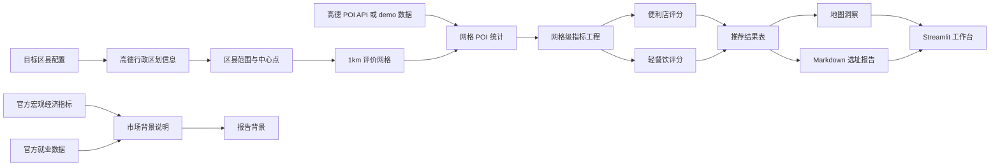
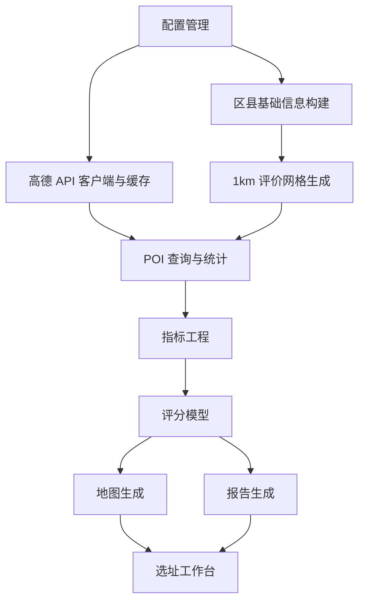

# 技术路线草图

## v2 数据流



## v2 模块流



## 路线说明

1. 官方宏观经济指标和就业数据用于市场背景、消费能力和就业客群说明。
2. 高德行政区划 API 用于目标区县基础信息和边界信息。
3. 高德 POI API 用于网格级 POI 样本统计；无 `AMAP_KEY` 时使用 demo 数据。
4. 1km 评价网格是最终评分对象。
5. 区县用于范围约束、背景画像和结果分组，不替代网格级推荐。
6. 输出为优先考察网格、地图洞察和 Markdown 选址报告。

## 当前执行入口

当前仓库仍保留 v1 执行入口：

```bash
python -m src.data.official_pipeline
python -m src.osm.inventory
python -m src.osm.pipeline --no-download
python -m src.selection.two_stage --top-n 5 --grid-size-m 1000
python -m src.visualization.map_viz
python -m src.reporting.report_generator --template
streamlit run src/app.py
```

v2 执行入口将在后续 Step 2 到 Step 18 中逐步补齐。
