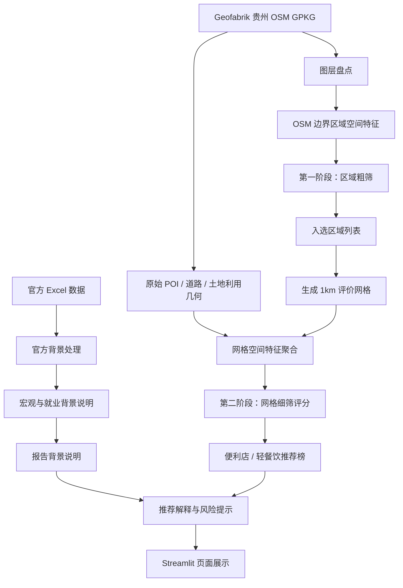

# 技术路线草图



## 路线说明

1. 官方宏观和就业数据用于描述贵州整体市场环境。
2. OSM 空间数据用于形成区域和网格之间的差异。
3. 第一阶段以 OSM 边界评价区域做粗筛。
4. 第二阶段只在入选区域内生成 1km 评价网格并重新聚合空间特征。
5. 输出为网格级优先考察区域，不是门牌号级推荐。

## 当前执行入口

```bash
python -m src.selection.two_stage --top-n 5
streamlit run src/app.py
```
