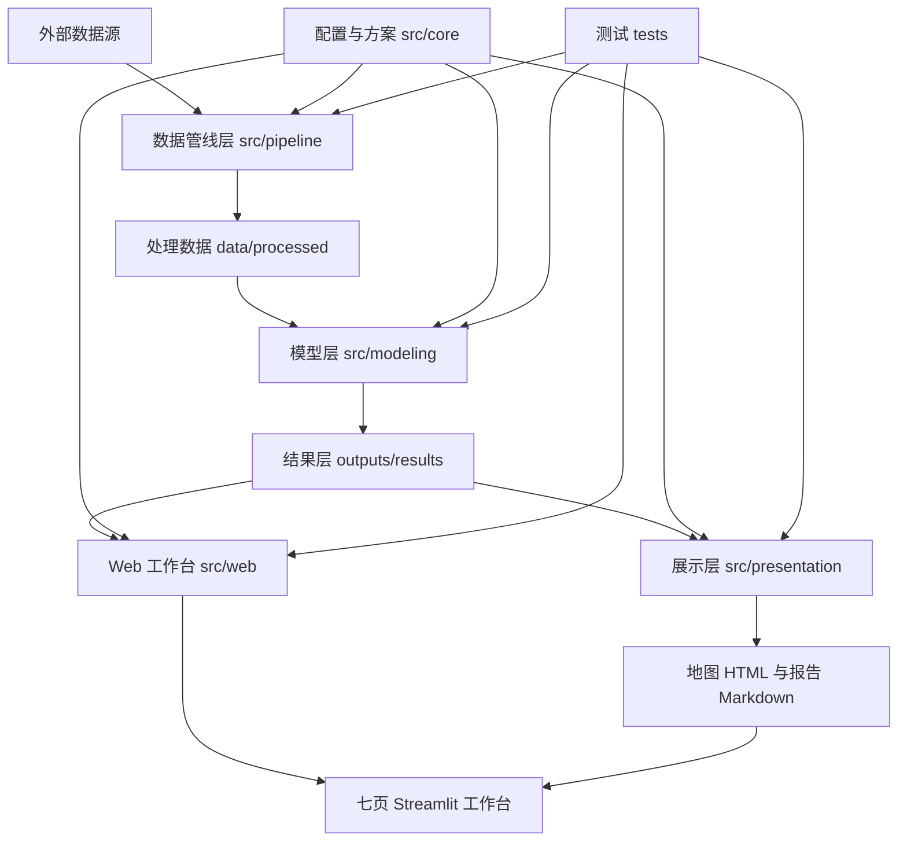
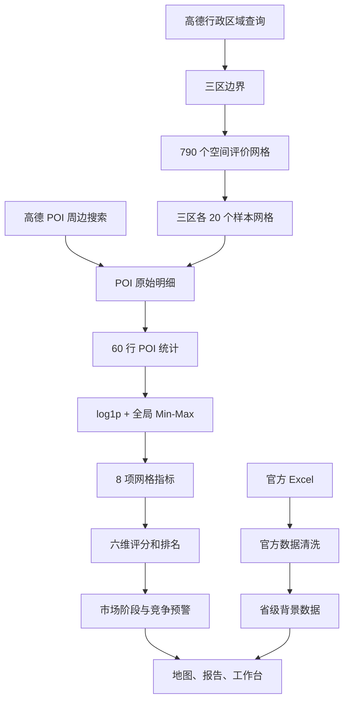
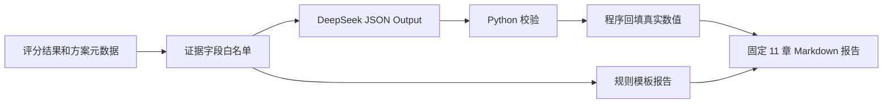
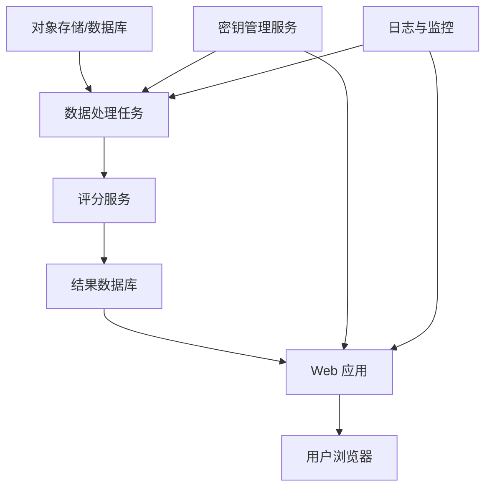

# 黔址优选系统架构说明

> 项目名称：黔址优选  
> 架构对象：v2 当前主线  
> 撰写日期：2026 年 6 月 16 日  
> 适用场景：比赛技术材料、PPT 架构页、项目交付说明  

## 一、架构目标

本系统面向“社区商业智能选址”场景，目标是在数据有限但需要快速初筛的条件下，形成一套可运行、可解释、可复现、可展示的选址辅助工作台。

架构设计遵循以下原则：

1. **真实数据优先**：代码、文档和页面说明必须依据真实文件、真实输出和真实运行边界。
2. **数据职责分层**：官方宏观数据、高德边界、POI 样本、评分结果各自只承担其能支持的解释职责。
3. **默认离线可复现**：默认一键运行不调用外部 API，使用已跟踪样本输入重建指标、评分、地图和模板报告。
4. **联网能力显式开启**：高德刷新和 DeepSeek 报告必须由命令参数或页面按钮触发。
5. **模型可解释**：从 POI 计数到综合排名的每一步都有公式、字段和案例支撑。
6. **主线与历史隔离**：v1 保留为归档实现，不参与当前默认入口。

## 二、总体架构



系统采用本地 Python 应用架构。当前主线不是前后端分离服务，而是以 `scripts/run_pipeline.py` 作为离线复现入口，以 `src/app.py` 作为 Streamlit 工作台入口。地图和报告作为展示成果写入 `outputs/figures/` 与 `outputs/reports/`。

## 三、运行入口

### 3.1 一键离线复现

```powershell
python scripts/run_pipeline.py
```

默认流程依次执行：

1. 校验已有区县、边界、网格、POI 样本和官方处理数据。
2. 重建网格级指标。
3. 生成两类默认评分和方案元数据。
4. 生成两张默认地图。
5. 生成两类 Top 1 规则模板报告。
6. 写出一键运行摘要。

该命令默认不刷新高德数据、不调用 DeepSeek、不启动 Streamlit。

### 3.2 可选运行参数

| 参数 | 作用 | 外部依赖 |
|---|---|---|
| `--refresh-official` | 重新处理官方 Excel | 本地原始 Excel |
| `--refresh-amap` | 在线刷新行政区划、网格和 POI 样本 | `AMAP_KEY` |
| `--with-llm` | 使用 DeepSeek 生成报告 | `DEEPSEEK_API_KEY` |
| `--serve` | 验收后启动 Streamlit 工作台 | 本机端口 8501 |

### 3.3 工作台入口

```powershell
streamlit run src/app.py
```

`src/app.py` 是当前主线唯一 Streamlit 入口，负责页面注册、视觉外壳和导航。当前运行环境支持 `st.Page` 与 `st.navigation`；旧版 Streamlit 环境可退化为 sidebar radio。

## 四、模块架构

### 4.1 共享核心层：`src/core/`

| 模块 | 职责 |
|---|---|
| `config.py` | 读取根目录 `config.yaml`，解析项目路径、POI 类别、默认权重和目录 |
| `profile_catalog.py` | 读取默认和自定义评分方案元数据，供地图、报告和页面共享 |

核心层不依赖 Streamlit、地图、报告或旧版实现。

### 4.2 数据管线层：`src/pipeline/`

| 模块 | 职责 |
|---|---|
| `official/official_pipeline.py` | 清洗官方宏观与就业数据，形成省级背景数据 |
| `amap_client.py` | 高德 Web 服务客户端、本地 JSON 缓存和错误处理 |
| `district_builder.py` | 获取目标区县名称、编码、中心点和边界 |
| `grid_builder.py` | 根据区县边界生成 1km 空间评价网格 |
| `poi_fetcher.py` | 对样本网格执行 POI 查询、分页、去重和统计 |

数据管线层负责把外部数据转换为当前处理数据，不负责评分、不直接渲染页面。

### 4.3 模型层：`src/modeling/`

| 模块 | 职责 |
|---|---|
| `feature_engineering.py` | 将 15 类 POI 计数转换为 8 项网格指标 |
| `scoring_model.py` | 执行默认方案和自定义方案的六维评分、排名和推荐等级 |
| `market_diagnostics.py` | 使用活跃网格三分位进行市场阶段和竞争预警诊断 |
| `interactive_scoring.py` | 支持前端权重预算、即时预览和正式保存方案 |

模型层不调用外部 API，不依赖 Streamlit。它读取处理数据，输出结构化评分结果。

### 4.4 展示成果层：`src/presentation/`

| 模块 | 职责 |
|---|---|
| `map_viz.py` | 生成高德 JS API 地图，凭据缺失时使用 Folium 兼容地图 |
| `report_generator.py` | 生成规则模板报告或 DeepSeek 结构化报告 |

展示层读取评分结果、方案元数据和网格边界，将其转换为 HTML 地图和 Markdown 报告。

### 4.5 Web 工作台层：`src/web/`

| 模块 | 职责 |
|---|---|
| `decision_context.py` | 在网格推荐、地图洞察和智能报告之间保存评分方案与网格选择 |
| `pages/overview.py` | 项目总览 |
| `pages/data_foundation.py` | 数据底座 |
| `pages/district_compare.py` | 区域对比 |
| `pages/grid_recommendation.py` | 网格推荐和自定义权重 |
| `pages/map_insight.py` | 地图洞察 |
| `pages/report_center.py` | 智能报告 |
| `pages/project_notes.py` | 项目说明 |
| `ui/workbench.py` | 共享视觉样式、标题栏、图例和页面组件 |

Web 层只消费已有数据和模型接口，不自行重新定义评分公式。

## 五、数据架构

### 5.1 数据来源

| 数据类型 | 来源 | 当前作用 |
|---|---|---|
| 官方宏观数据 | 赛事官方 Excel | 贵州省级市场背景 |
| 官方就业数据 | 赛事官方 Excel | 贵州省级就业背景和边界说明 |
| 行政区划 | 高德行政区域查询 | 三区名称、编码、中心点和边界 |
| POI 数据 | 高德地点搜索 2.0 | 样本网格周边设施、客群和竞争代理 |
| 派生数据 | 本项目空间和模型计算 | 网格、指标、评分、诊断、地图和报告 |

高德行政区域查询官方文档说明街道级别不能返回边界 `polyline`，因此本系统以区县边界作为真实空间边界。高德 POI 2.0 官方文档说明地点搜索不支持返回全量数据，同一请求参数翻页最多支持获取 200 条数据，因此本项目把 POI 明确定位为统一口径样本，不写成全量设施库。

### 5.2 数据流



### 5.3 当前关键数据规模

| 指标 | 当前值 |
|---|---:|
| 目标区县 | 3 个 |
| 空间评价网格 | 790 个 |
| POI 样本网格 | 60 个 |
| 有 POI 活动网格 | 41 个 |
| 无 POI 活动网格 | 19 个 |
| POI 类别 | 15 类 |
| 网格级衍生指标 | 8 项 |
| 默认评分方案 | 2 套 |

### 5.4 输出数据

| 类型 | 说明 |
|---|---|
| 网格评分输入 | 15 类 POI 计数、审计字段和 8 项指标 |
| 评分结果 | 两类默认方案得分、排名、推荐等级、优势风险和诊断 |
| 区县汇总 | 三区样本数量、活跃网格、平均分、最高分网格和诊断计数 |
| 方案元数据 | 默认与自定义方案的模板、权重和展示信息 |
| 地图 HTML | 便利店和轻餐饮默认地图，以及自定义方案地图 |
| 选址报告 | 规则模板或 DeepSeek 结构化报告 |
| 运行摘要 | 一键流程阶段耗时和验收指标 |

## 六、模型架构

### 6.1 指标工程

15 类 POI 计数先执行：

$$
y_{ij}=\ln(1+x_{ij})
$$

随后在 60 个样本网格范围内按字段执行全局 Min-Max：

$$
z_{ij}=
\frac{y_{ij}-\min(y_j)}
{\max(y_j)-\min(y_j)}
\times100
$$

归一化后构造 8 项指标：

| 指标 | 组成 |
|---|---|
| 交通可达性 | 公交站、地铁站、停车场 |
| 消费潜力 | 小区、超市、商场、学校、医院 |
| 就业/办公客群代理 | 写字楼、商场、学校、餐饮 |
| 商业氛围 | 商场、餐饮、咖啡、茶饮、超市 |
| 便利店共生业态 | 小区、学校、医院、公交站、超市 |
| 轻餐饮共生业态 | 写字楼、学校、商场、公交站、咖啡、茶饮 |
| 便利店竞争压力 | 便利店、超市 |
| 轻餐饮竞争压力 | 餐饮、快餐、小吃、咖啡、茶饮 |

### 6.2 六维评分

综合得分公式为：

$$
S_i=
w_tT_i+
w_cC^{pot}_i+
w_eE_i+
w_yY_i+
w_p(100-P_i)+
w_bB_i
$$

其中：

- \(T_i\)：交通可达性。
- \(C^{pot}_i\)：消费潜力。
- \(E_i\)：就业/办公客群代理。
- \(Y_i\)：业态对应共生指标。
- \(P_i\)：业态对应竞争压力。
- \(B_i\)：商业氛围。

无 POI 活动网格强制得分为 0，排名留空，推荐等级为“暂不推荐”。

### 6.3 排名规则

只有 41 个有 POI 活动网格参与排名。排序键依次为：

1. 未四舍五入综合得分降序。
2. POI 类别计数总和降序。
3. 网格标识升序。

推荐等级按有效排名比例划分：

| 范围 | 当前数量 | 等级 |
|---|---:|---|
| 前 20%，向上取整 | 9 | 推荐 |
| 前 60% 以内且不属于前 20% | 16 | 谨慎推荐 |
| 其余有效排名网格 | 16 | 暂不推荐 |
| 无 POI 活动 | 19 | 暂不推荐且排名留空 |

### 6.4 市场诊断

市场诊断不改变综合得分和排名。系统只使用有 POI 活动的网格，按 \(1/3\) 和 \(2/3\) 分位点将指标划分为低位、适中和高位，形成：

- 市场空白型。
- 待培育型。
- 成熟商圈型。
- 一般观察型。
- 过度竞争预警。

需求客群代理为：

$$
D_i=\frac{C^{pot}_i+E_i}{2}
$$

该值不是真实客流，只用于样本网格相对分层。

## 七、报告与大模型架构

智能报告采用“结构化生成 + 程序渲染”的受控架构：



设计要点：

1. DeepSeek 不直接控制评分、排名和诊断标签。
2. 提示词只允许使用程序提供的证据字段。
3. 返回内容采用 JSON Output，便于程序解析和校验。
4. 程序回填真实分数、排名、坐标、权重和数据边界。
5. API 不可用时，可由用户选择规则模板报告。
6. 报告固定 11 章，避免自由扩写导致结构漂移。

DeepSeek 官方文档提供 JSON Output 能力；项目使用该能力服务于结构化解析，而不是让大模型直接生成不可校验的最终结论。

## 八、Web 工作台架构

### 8.1 页面结构

| 页面 | 作用 |
|---|---|
| 项目总览 | 项目定位、范围、主题 POI、区县平均分 |
| 数据底座 | 数据来源、记录数、用途和边界 |
| 区域对比 | 三区 POI、评分和诊断对比 |
| 网格推荐 | 方案选择、权重自定义、Top 结果、指标分解 |
| 地图洞察 | 790 个空间网格状态、Top 标记、点击详情 |
| 智能报告 | 选择方案和网格，生成或下载报告 |
| 项目说明 | 当前能力、限制和运行方式 |

### 8.2 页面协同

`decision_context.py` 在网格推荐、地图洞察和智能报告之间保存选择状态。用户在网格推荐页选择方案和网格后，地图页和报告页可复用同一决策上下文，减少重复选择。

### 8.3 导航实现

Streamlit 官方文档说明，使用 `st.navigation` 时入口文件承担页面路由职责，每个页面可以由入口文件注册后执行。本项目将页面注册集中在 `src/app.py`，页面正文放入 `src/web/pages/`，共享样式放入 `src/web/ui/`。

## 九、地图架构

地图生成采用双路径：

| 路径 | 条件 | 说明 |
|---|---|---|
| 高德 JS API 主链 | 存在 `AMAP_JS_KEY` 和 `AMAP_JS_SECURITY_CODE` | 直接渲染 GCJ-02 网格，与高德数据同源 |
| Folium 兼容回退 | 高德 JS 凭据缺失 | 生成可打开 HTML，作为本地演示兜底 |

地图表达 790 个空间网格，并区分：

- 未采集 POI。
- 已采集但无 POI 活动。
- 有有效评分。
- 全局 Top 10。

地图颜色按评分区间表达，诊断标签进入悬停或点击详情，但不改变评分颜色。

## 十、安全与配置

### 10.1 凭据管理

系统使用环境变量读取外部服务凭据：

| 环境变量 | 用途 |
|---|---|
| `AMAP_KEY` | 高德行政区划和 POI Web 服务 |
| `AMAP_JS_KEY` | 高德地图 JS API |
| `AMAP_JS_SECURITY_CODE` | 高德地图 JS API 安全密钥 |
| `DEEPSEEK_API_KEY` | DeepSeek 智能报告 |

凭据不写入 `config.yaml`、源码、日志或文档。

### 10.2 数据安全边界

当前数据不包含个人隐私、手机号、身份证、订单流水等敏感个人信息。后续若接入客户经营数据、租金数据或客流数据，必须增加：

1. 数据授权记录。
2. 脱敏和最小化字段设计。
3. 访问权限控制。
4. 日志脱敏。
5. 数据删除和交付边界。

## 十一、可靠性设计

| 机制 | 作用 |
|---|---|
| 本地缓存 | 避免重复请求高德，降低外部接口波动影响 |
| 显式刷新参数 | 默认离线复现不依赖网络 |
| 原子输出 | 多文件输出失败时回滚，避免新旧结果混合 |
| 数据校验 | 字段缺失、重复网格、负数计数、非法权重会报错 |
| 无活动保护 | 防止零 POI 网格因低竞争被误判为优质 |
| 测试覆盖 | core、pipeline、modeling、presentation、web、integration 分层验证 |
| v1 隔离 | 历史实现保留但不污染当前入口 |

## 十二、部署架构

### 12.1 当前本地演示部署


### 12.2 后续云端部署建议

若进入试点或商业化阶段，建议演进为：



云端化需要补齐：

- 用户账号和权限。
- 多项目、多城市数据隔离。
- 任务队列和异步报告生成。
- API 配额监控。
- 数据库迁移和备份。
- HTTPS 和访问日志。

当前比赛原型尚未实现这些云端能力，因此不能写成已完成。

## 十三、测试与验证

当前项目按职责设置测试目录：

| 测试目录 | 验证范围 |
|---|---|
| `tests/core/` | 配置和方案目录 |
| `tests/pipeline/` | 高德、区县、网格、POI 管线 |
| `tests/modeling/` | 指标工程、评分、诊断、自定义权重 |
| `tests/presentation/` | 地图和报告 |
| `tests/web/` | 工作台页面和交互逻辑 |
| `tests/integration/` | 模块边界、一键流程和 v1 隔离 |
| `tests/legacy/v1/` | 旧版可运行归档 |

常用验证命令：

```powershell
python -m unittest discover -s tests -v
python -c "import ast, pathlib; [ast.parse(p.read_text(encoding='utf-8'), filename=str(p)) for p in pathlib.Path('src').rglob('*.py')]; ast.parse(pathlib.Path('scripts/run_pipeline.py').read_text(encoding='utf-8')); print('syntax ok')"
git diff --check
```

## 十四、当前架构边界

1. 当前只覆盖云岩区、南明区、观山湖区。
2. 当前 POI 统计只覆盖 60 个样本网格，不是 790 个网格全量采集。
3. 当前评分只对 41 个有 POI 活动网格排名。
4. 官方宏观和就业数据只进入省级背景说明，不进入网格评分。
5. 默认权重为比赛原型业务经验设定，不是经营结果训练参数。
6. 智能报告是辅助分析，不是合同、审批、投资或开店保证。
7. 当前本地工作台没有用户登录、权限、多租户和云端任务队列。
8. Step 18 是当前总控终点，后续路线不能自动写成已实现能力。

## 十五、PPT 架构页建议

PPT 中可将本架构压缩为 3 页：

1. **总体架构页**：外部数据源、数据管线、模型层、展示层、工作台。
2. **数据与模型页**：三区边界、790 网格、60 样本、15 类 POI、8 项指标、六维评分。
3. **工程保障页**：默认离线复现、显式联网、原子输出、测试、凭据环境变量、v1 隔离。

推荐标题：

> 从公共数据到选址决策：可复现、可解释、可交互的社区商业 AI 工作台

## 附录 A：外部技术依据

- 高德开放平台：[行政区域查询](https://lbs.amap.com/api/webservice/guide/api/district)。
- 高德开放平台：[搜索 POI 2.0](https://lbs.amap.com/api/webservice/guide/api-advanced/newpoisearch)。
- Streamlit：[st.Page](https://docs.streamlit.io/develop/api-reference/navigation/st.page) 与 [st.navigation 页面机制](https://docs.streamlit.io/develop/concepts/multipage-apps/page-and-navigation)。
- DeepSeek：[JSON Output](https://api-docs.deepseek.com/guides/json_mode) 与 [Thinking Mode](https://api-docs.deepseek.com/guides/thinking_mode)。

## 附录 B：项目内依据

- `README.md`
- `docs/项目结构说明.md`
- `docs/最终交付清单.md`
- `docs/黔址优选_v2项目说明材料.md`
- `docs/网格推荐全流程与评分计算说明.md`
- `outputs/results/recommendation_summary.md`
- `outputs/results/pipeline_run_summary.md`
