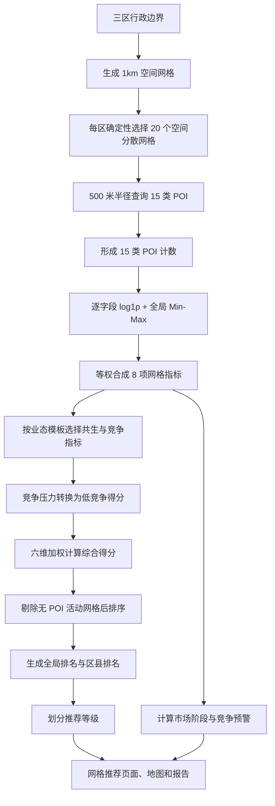

# 网格推荐全流程与评分计算说明

## 1. 文档目的

本文依据当前 v2 仓库的真实代码、配置和正式数据，完整说明网格推荐从空间网格、POI 统计、指标工程、六维评分到排名与推荐等级的计算过程。

本文使用的主要依据为：

- `config.yaml`
- `src/modeling/feature_engineering.py`
- `src/modeling/scoring_model.py`
- `src/modeling/market_diagnostics.py`
- `src/modeling/interactive_scoring.py`
- `data/processed/grid_poi_counts.csv`
- `data/processed/grid_scoring_input.csv`
- `outputs/results/grid_stage_score_result.csv`

本文中的案例数值均来自当前正式数据，并按代码公式重新计算。页面通常显示两位小数，但实际排名使用未四舍五入的综合得分。

## 2. 当前计算范围

当前推荐流程的真实范围为：

| 项目 | 当前范围 |
|---|---:|
| 目标区县 | 云岩区、南明区、观山湖区 |
| 完整空间网格 | 790 个 |
| POI 样本网格 | 60 个，三区各 20 个 |
| 有 POI 活动的网格 | 41 个 |
| 无 POI 活动的网格 | 19 个 |
| POI 类别 | 15 类 |
| 网格级衍生指标 | 8 项 |
| 默认评分方案 | 社区便利店、轻餐饮 |

790 个空间网格用于表达完整研究范围，但当前只有 60 个样本网格进入 POI 指标和评分流程。未采集 POI 的空间网格不被填成零分，也不参与评分排名。

## 3. 全流程概览



## 4. 空间网格与 POI 样本

### 4.1 1km 网格

空间计算先将区县边界放入 `EPSG:32648` 米制坐标空间，在统一的 1000 米整数轴上生成方格，再与区县边界求交。

边缘网格可能被裁剪，因此实际面积可以小于 1 平方公里。评分对象仍称为 1km 评价网格，表示其来源于 1000m × 1000m 的统一格网。

### 4.2 每区 20 个空间分散样本网格

当前没有对 790 个网格全部查询 POI，而是在每个区县中确定性选择 20 个网格：

1. 首先选择最接近该区网格中心位置的网格。
2. 后续选择与已选网格集合的最小距离最大的网格。
3. 距离相同时按 `grid_id` 排序。
4. 相同输入重复执行会得到相同的 60 个样本网格。

### 4.3 POI 查询口径

每个样本网格以中心点为圆心，默认查询半径为 500 米。15 类 POI 为：

| 分组 | POI 类别 |
|---|---|
| 社区零售 | 便利店、超市 |
| 餐饮消费 | 餐饮、快餐、小吃、咖啡、茶饮 |
| 生活客群 | 学校、医院、小区 |
| 商业办公 | 商场、写字楼 |
| 交通配套 | 公交站、地铁站、停车场 |

默认每类最多查询 2 页，每页 25 条。同一网格、同一类别内按非空 POI 标识去重；不同类别之间允许交叉，因此 15 类计数之和不代表跨类别去重后的唯一设施数量。

## 5. POI 计数预处理

设：

- \(x_{ij}\)：网格 \(i\) 的第 \(j\) 类 POI 原始计数。
- \(y_{ij}\)：执行对数变换后的值。
- \(z_{ij}\)：归一化到 0 至 100 后的值。

### 5.1 数据校验

每个计数字段先执行以下处理：

1. 空值填 0。
2. 非数字值直接报错。
3. 负数直接报错。
4. 每个 `grid_id` 必须唯一。
5. POI 表中的区县必须与空间网格表一致。

### 5.2 `log1p` 变换

对每个 POI 计数执行：

$$
y_{ij}=\ln(1+x_{ij})
$$

使用 \(\ln(1+x)\) 而不是直接使用 \(x\)，目的是压缩大计数的尺度，避免数量特别高的类别完全支配指标。

例如：

$$
\ln(1+3)=\ln 4\approx1.386294
$$

$$
\ln(1+50)=\ln 51\approx3.931826
$$

原始计数从 3 增长到 50，数值增长约 16.67 倍；经过对数变换后，只从 1.386294 增长到 3.931826。

### 5.3 全局 Min-Max 归一化

每个 POI 类别分别在全部 60 个样本网格上进行全局归一化：

$$
z_{ij}=
\frac{y_{ij}-\min(y_j)}
{\max(y_j)-\min(y_j)}
\times100
$$

其中：

- \(\min(y_j)\) 是第 \(j\) 类 POI 在 60 个网格中的最小对数值。
- \(\max(y_j)\) 是第 \(j\) 类 POI 在 60 个网格中的最大对数值。
- 不按区县分别归一化，三区网格使用同一尺度。

若某个字段在 60 个网格中是常量，即：

$$
\max(y_j)=\min(y_j)
$$

则该字段全部归零，因为该字段不能区分网格。

## 6. 八项网格级衍生指标

设各 POI 类别归一化值如下：

| 符号 | 字段 |
|---|---|
| \(z_{conv}\) | 便利店 |
| \(z_{super}\) | 超市 |
| \(z_{rest}\) | 餐饮 |
| \(z_{fast}\) | 快餐 |
| \(z_{snack}\) | 小吃 |
| \(z_{cafe}\) | 咖啡 |
| \(z_{tea}\) | 茶饮 |
| \(z_{school}\) | 学校 |
| \(z_{hospital}\) | 医院 |
| \(z_{mall}\) | 商场 |
| \(z_{office}\) | 写字楼 |
| \(z_{residential}\) | 小区 |
| \(z_{bus}\) | 公交站 |
| \(z_{subway}\) | 地铁站 |
| \(z_{parking}\) | 停车场 |

复合指标均为组成字段归一化值的等权平均。

### 6.1 交通可达性

字段：`traffic_accessibility`

$$
T=
\frac{
z_{bus}+z_{subway}+z_{parking}
}{3}
$$

该指标只反映公交站、地铁站和停车场 POI 的相对强弱，不等同于道路密度、步行时间或真实交通流量。

### 6.2 消费潜力

字段：`consumption_potential`

$$
C^{pot}=
\frac{
z_{residential}+z_{super}+z_{mall}+z_{school}+z_{hospital}
}{5}
$$

该指标使用小区、超市、商场、学校和医院作为生活消费场景代理，不代表真实消费金额。

### 6.3 就业/办公客群代理

字段：`employment_customer_proxy`

$$
E=
\frac{
z_{office}+z_{mall}+z_{school}+z_{rest}
}{4}
$$

该指标是 POI 结构形成的空间代理，不代表真实就业人口、学生人数或客流。

### 6.4 商业氛围

字段：`business_atmosphere`

$$
B=
\frac{
z_{mall}+z_{rest}+z_{cafe}+z_{tea}+z_{super}
}{5}
$$

### 6.5 便利店共生业态

字段：`convenience_synergy_score`

$$
Y_{conv}=
\frac{
z_{residential}+z_{school}+z_{hospital}+z_{bus}+z_{super}
}{5}
$$

### 6.6 轻餐饮共生业态

字段：`light_food_synergy_score`

$$
Y_{food}=
\frac{
z_{office}+z_{school}+z_{mall}+z_{bus}+z_{cafe}+z_{tea}
}{6}
$$

### 6.7 便利店竞争压力

字段：`convenience_competition_pressure`

$$
P_{conv}=
\frac{
z_{conv}+z_{super}
}{2}
$$

### 6.8 轻餐饮竞争压力

字段：`light_food_competition_pressure`

$$
P_{food}=
\frac{
z_{rest}+z_{fast}+z_{snack}+z_{cafe}+z_{tea}
}{5}
$$

## 7. POI 活动审计字段

每个样本网格还会生成三个审计字段。

### 7.1 POI 类别计数总和

字段：`poi_total_count`

$$
N_i=\sum_{j=1}^{15}x_{ij}
$$

该值是 15 类计数之和，不代表唯一 POI 数。

### 7.2 非零类别数量

字段：`poi_category_coverage`

$$
K_i=\sum_{j=1}^{15}I(x_{ij}>0)
$$

其中 \(I(\cdot)\) 为指示函数。

### 7.3 是否有 POI 活动

字段：`has_poi_activity`

$$
A_i=
\begin{cases}
\text{True}, & N_i>0\\
\text{False}, & N_i=0
\end{cases}
$$

无 POI 活动网格仍保留在结果中，但后续综合得分固定为 0，排名留空。

## 8. 业态模板与六维评分

### 8.1 六个评分维度

每个评分方案都使用以下六个正向维度：

1. 交通可达性 \(T\)
2. 消费潜力 \(C^{pot}\)
3. 就业/办公客群代理 \(E\)
4. 业态对应的共生指标 \(Y\)
5. 低竞争得分 \(C\)
6. 商业氛围 \(B\)

### 8.2 竞争压力反向

竞争压力是负向指标，不能直接作为正向得分相加，因此先转换为低竞争得分：

$$
C=100-P
$$

便利店：

$$
C_{conv}=100-P_{conv}
$$

轻餐饮：

$$
C_{food}=100-P_{food}
$$

竞争压力越高，低竞争得分越低。

### 8.3 通用综合得分公式

$$
S_i=
w_tT_i+
w_cC^{pot}_i+
w_eE_i+
w_yY_i+
w_pC_i+
w_bB_i
$$

约束条件为：

$$
w_t+w_c+w_e+w_y+w_p+w_b=1
$$

$$
w_k\geq0
$$

### 8.4 默认社区便利店方案

社区便利店使用：

- 共生指标：\(Y_{conv}\)
- 竞争压力：\(P_{conv}\)

权重为：

| 维度 | 权重 |
|---|---:|
| 交通可达性 | 0.20 |
| 消费潜力 | 0.25 |
| 就业/办公客群代理 | 0.10 |
| 便利店共生业态 | 0.20 |
| 低竞争得分 | 0.15 |
| 商业氛围 | 0.10 |

因此：

$$
S_{conv}=
0.20T+
0.25C^{pot}+
0.10E+
0.20Y_{conv}+
0.15C_{conv}+
0.10B
$$

### 8.5 默认轻餐饮方案

轻餐饮使用：

- 共生指标：\(Y_{food}\)
- 竞争压力：\(P_{food}\)

权重为：

| 维度 | 权重 |
|---|---:|
| 交通可达性 | 0.15 |
| 消费潜力 | 0.10 |
| 就业/办公客群代理 | 0.25 |
| 轻餐饮共生业态 | 0.20 |
| 低竞争得分 | 0.15 |
| 商业氛围 | 0.15 |

因此：

$$
S_{food}=
0.15T+
0.10C^{pot}+
0.25E+
0.20Y_{food}+
0.15C_{food}+
0.15B
$$

### 8.6 无 POI 活动网格的强制处理

即使一个全零网格的竞争压力为 0，计算得到的低竞争得分会是 100，也不能把它解释为优质位置。

代码在综合得分计算后执行：

$$
S_i=0,\quad \text{if } A_i=\text{False}
$$

同时：

- 全局排名留空。
- 区县排名留空。
- 推荐等级固定为“暂不推荐”。
- 主要优势固定为“未检测到POI活动”。
- 主要风险固定为“缺少可用于推荐的POI活动”。

## 9. 排名计算

### 9.1 参与排名的网格

只有：

$$
A_i=\text{True}
$$

的 41 个网格参与排名。

### 9.2 全局排名

全局排名依次使用三个排序键：

1. 未四舍五入综合得分降序。
2. `poi_total_count` 降序。
3. `grid_id` 升序。

可写为：

$$
\text{sort key}=
(-S_i,-N_i,\text{grid\_id}_i)
$$

页面显示两位小数不影响排名。两个网格即使页面都显示为 38.23，仍会先比较代码中的完整浮点得分。

### 9.3 区县排名

区县排名使用同一套排序规则，但只在各自区县的有活动网格内部计算。

因此，一个网格可以同时拥有：

- 全市全局排名。
- 所属区县内部排名。

## 10. 推荐等级

当前有活动网格数为：

$$
n=41
$$

推荐分界点为：

$$
r_{recommend}=\lceil0.20n\rceil
=\lceil8.2\rceil=9
$$

谨慎推荐分界点为：

$$
r_{cautious}=\lceil0.60n\rceil
=\lceil24.6\rceil=25
$$

因此：

| 全局排名 | 推荐等级 | 当前数量 |
|---|---|---:|
| 1 至 9 | 推荐 | 9 |
| 10 至 25 | 谨慎推荐 | 16 |
| 26 至 41 | 暂不推荐 | 16 |
| 排名留空 | 暂不推荐 | 19 |

推荐等级依据全局排名计算，不依据区县排名计算。

## 11. 主要优势与主要风险

### 11.1 主要优势

对以下六个正向值取最大值：

$$
\max
\left(
T,C^{pot},E,Y,C,B
\right)
$$

对应文案分别为：

- 交通可达性
- 消费潜力
- 就业客群代理
- 共生业态匹配
- 竞争压力较低
- 商业氛围

### 11.2 主要风险

对以下六个风险值取最大值：

$$
\max
\left(
100-T,
100-C^{pot},
100-E,
100-Y,
P,
100-B
\right)
$$

对应文案分别为：

- 交通可达性不足
- 消费潜力不足
- 就业客群代理不足
- 共生业态匹配不足
- 竞争压力较高
- 商业氛围不足

优势与风险使用指标本身比较，不乘评分权重。因此它们解释“哪项客观指标最突出或缺口最大”，不是解释“哪项权重贡献最大”。

## 12. 区域市场诊断

市场诊断与综合评分相互独立，不改变综合得分、排名或推荐等级。

### 12.1 需求客群代理

$$
D=
\frac{
C^{pot}+E
}{2}
$$

该值不是真实客流。

### 12.2 全市统一三分位

只使用 41 个有活动网格，对以下字段分别计算 \(1/3\) 和 \(2/3\) 分位点：

$$
P_{low}=Q\left(\frac{1}{3}\right)
$$

$$
P_{high}=Q\left(\frac{2}{3}\right)
$$

下文为便于阅读，将二者简称为 P33 和 P67。这里的 P33/P67 是三等分位置的简称，代码实际传入的是精确的 \(1/3\) 和 \(2/3\)，不是小数 0.33 和 0.67。

- 消费潜力
- 需求客群代理
- 商业氛围
- 业态对应的共生指标
- 业态对应的竞争压力

通常：

$$
x\leq P33 \Rightarrow \text{低位}
$$

$$
P33<x<P67 \Rightarrow \text{适中}
$$

$$
x\geq P67 \Rightarrow \text{高位}
$$

若 P33 与 P67 相同，则代码使用严格边界：

- 小于阈值为低位。
- 等于阈值为适中。
- 大于阈值为高位。

### 12.3 市场阶段规则

市场空白型：

$$
C^{pot}_{high}
\land
Y_{high}
\land
B_{medium}
\land
\neg P_{high}
$$

待培育型：

$$
P_{low}
\land
B_{low}
\land
Y_{low}
$$

成熟商圈型：

$$
B_{high}
\land
Y_{high}
\land
P_{high}
$$

其余有活动网格为一般观察型。

### 12.4 过度竞争预警

$$
B_{high}
\land
D_{high}
\land
P_{high}
$$

市场阶段和竞争预警可以同时成立。例如，一个网格可以同时是“成熟商圈型”和“过度竞争预警”。

## 13. 自定义权重

### 13.1 模板与权重分离

自定义方案必须先选择一种指标模板：

| 模板 | 共生指标 | 竞争指标 |
|---|---|---|
| `community_retail` | 便利店共生业态 | 便利店竞争压力 |
| `food_service` | 轻餐饮共生业态 | 轻餐饮竞争压力 |

模板决定使用哪组共生和竞争数据，权重决定六个维度的贡献大小。

### 13.2 即时预览归一化

若用户输入六项非负权重，但总和不等于 100%，即时预览会将其确定性归一到 100.00%。

基础比例为：

$$
q_k=\frac{p_k}{\sum p_k}\times100
$$

系统以 0.01 个百分点为单位执行最大余数分配：

1. 先对每项向下取整到 0.01%。
2. 计算还缺少多少个 0.01%。
3. 按小数余数从大到小补齐。
4. 余数相同时按六个固定字段顺序补齐。

### 13.3 自定义权重示例

输入：

| 维度 | 输入值 |
|---|---:|
| 交通可达性 | 20 |
| 消费潜力 | 30 |
| 就业/办公客群代理 | 10 |
| 共生业态 | 15 |
| 竞争压力 | 10 |
| 商业氛围 | 5 |
| 合计 | 90 |

归一化结果：

| 维度 | 归一化百分比 | 后端权重 |
|---|---:|---:|
| 交通可达性 | 22.22% | 0.2222 |
| 消费潜力 | 33.33% | 0.3333 |
| 就业/办公客群代理 | 11.11% | 0.1111 |
| 共生业态 | 16.67% | 0.1667 |
| 竞争压力 | 11.11% | 0.1111 |
| 商业氛围 | 5.56% | 0.0556 |
| 合计 | 100.00% | 1.0000 |

六项全部为 0 时禁止计算。正式保存方案时，用户输入值必须精确合计为 100.00%，不能依赖预览归一化代替正式确认。

## 14. 真实案例一：全局第 1 网格完整精算

案例网格：

```text
grid_id：grid_520103_000078
所属区县：云岩区
```

### 14.1 15 类原始计数与归一化

当前 15 个类别在 60 个样本网格中的最小值均为 0。下表列出案例网格原始计数、当前全局最大计数和归一化结果。

| POI 类别 | 原始计数 | 60 网格最大值 | 归一化值 |
|---|---:|---:|---:|
| 便利店 | 50 | 50 | 100.000000 |
| 超市 | 50 | 50 | 100.000000 |
| 餐饮 | 14 | 15 | 97.672265 |
| 快餐 | 50 | 50 | 100.000000 |
| 小吃 | 50 | 50 | 100.000000 |
| 咖啡 | 50 | 50 | 100.000000 |
| 茶饮 | 24 | 24 | 100.000000 |
| 学校 | 21 | 21 | 100.000000 |
| 医院 | 2 | 3 | 79.248125 |
| 商场 | 20 | 20 | 100.000000 |
| 写字楼 | 50 | 50 | 100.000000 |
| 小区 | 49 | 49 | 100.000000 |
| 公交站 | 23 | 23 | 100.000000 |
| 地铁站 | 1 | 1 | 100.000000 |
| 停车场 | 50 | 50 | 100.000000 |

餐饮归一化示例：

$$
z_{rest}=
\frac{\ln(1+14)-\ln(1+0)}
{\ln(1+15)-\ln(1+0)}
\times100
$$

$$
=
\frac{\ln15}{\ln16}
\times100
=97.672265
$$

医院归一化示例：

$$
z_{hospital}=
\frac{\ln(1+2)}
{\ln(1+3)}
\times100
=
\frac{\ln3}{\ln4}
\times100
=79.248125
$$

### 14.2 POI 活动审计

15 类原始计数总和：

$$
N=50+50+14+50+50+50+24+21+2+20+50+49+23+1+50=504
$$

15 个类别均大于 0，因此：

$$
K=15
$$

$$
A=\text{True}
$$

该网格进入正式评分和排名。

### 14.3 八项指标计算

交通可达性：

$$
T=
\frac{100+100+100}{3}
=100.000000
$$

消费潜力：

$$
C^{pot}=
\frac{
100+100+100+100+79.248125
}{5}
=95.849625
$$

就业/办公客群代理：

$$
E=
\frac{
100+100+100+97.672265
}{4}
=99.418066
$$

商业氛围：

$$
B=
\frac{
100+97.672265+100+100+100
}{5}
=99.534453
$$

便利店共生业态：

$$
Y_{conv}=
\frac{
100+100+79.248125+100+100
}{5}
=95.849625
$$

轻餐饮共生业态：

$$
Y_{food}=
\frac{
100+100+100+100+100+100
}{6}
=100.000000
$$

便利店竞争压力：

$$
P_{conv}=
\frac{100+100}{2}
=100.000000
$$

轻餐饮竞争压力：

$$
P_{food}=
\frac{
97.672265+100+100+100+100
}{5}
=99.534453
$$

### 14.4 社区便利店得分

低竞争得分：

$$
C_{conv}=100-100=0
$$

六项贡献：

| 维度 | 指标值 | 权重 | 得分贡献 |
|---|---:|---:|---:|
| 交通可达性 | 100.000000 | 0.20 | 20.000000 |
| 消费潜力 | 95.849625 | 0.25 | 23.962406 |
| 就业/办公客群代理 | 99.418066 | 0.10 | 9.941807 |
| 便利店共生业态 | 95.849625 | 0.20 | 19.169925 |
| 低竞争得分 | 0.000000 | 0.15 | 0.000000 |
| 商业氛围 | 99.534453 | 0.10 | 9.953445 |

完整计算：

$$
S_{conv}=
20.000000+
23.96240625+
9.94180660+
19.16992500+
0+
9.95344530
$$

$$
S_{conv}=83.02758315
$$

页面显示为：

$$
83.03
$$

### 14.5 轻餐饮得分

低竞争得分：

$$
C_{food}=100-99.534453=0.465547
$$

六项贡献：

| 维度 | 指标值 | 权重 | 得分贡献 |
|---|---:|---:|---:|
| 交通可达性 | 100.000000 | 0.15 | 15.000000 |
| 消费潜力 | 95.849625 | 0.10 | 9.584963 |
| 就业/办公客群代理 | 99.418066 | 0.25 | 24.854517 |
| 轻餐饮共生业态 | 100.000000 | 0.20 | 20.000000 |
| 低竞争得分 | 0.465547 | 0.15 | 0.069832 |
| 商业氛围 | 99.534453 | 0.15 | 14.930168 |

完整计算：

$$
S_{food}=
15.000000+
9.58496250+
24.85451650+
20.000000+
0.06983205+
14.93016795
$$

$$
S_{food}=84.43947900
$$

页面显示为：

$$
84.44
$$

### 14.6 排名、推荐等级和解释

正式结果：

| 方案 | 全局排名 | 云岩区排名 | 推荐等级 | 主要优势 | 主要风险 |
|---|---:|---:|---|---|---|
| 社区便利店 | 1 | 1 | 推荐 | 交通可达性 | 竞争压力较高 |
| 轻餐饮 | 1 | 1 | 推荐 | 交通可达性 | 竞争压力较高 |

优势判断：

- 交通可达性为 100，是六个正向维度中的最大值之一。
- `idxmax` 在相同最大值时返回字段顺序中最先出现的项目，因此显示“交通可达性”。

风险判断：

- 便利店竞争压力为 100。
- 轻餐饮竞争压力为 99.534453。
- 两者均为各自风险值中的最大项，因此显示“竞争压力较高”。

### 14.7 市场诊断

需求客群代理：

$$
D=
\frac{95.849625+99.418066}{2}
=97.6338455
$$

社区便利店当前 P67 阈值：

| 诊断字段 | P67 |
|---|---:|
| 消费潜力 | 35.290010 |
| 需求客群代理 | 26.442313 |
| 商业氛围 | 21.923598 |
| 便利店共生业态 | 42.090441 |
| 便利店竞争压力 | 59.447184 |

该网格的商业氛围、便利店共生和便利店竞争压力均处于高位，因此为“成熟商圈型”；商业氛围、需求客群代理和竞争压力也均处于高位，因此触发“过度竞争预警”。

轻餐饮同样满足成熟商圈和过度竞争预警条件。

该案例说明：综合得分第 1 不代表竞争压力低。该网格依靠交通、消费、客群、共生和商业氛围取得高分，同时存在明显竞争风险。

## 15. 真实案例二：得分相同时如何排名

以下三个真实网格的原始 POI 结构完全相同：

| `grid_id` | 区县 | 便利店 | 超市 | 其他 13 类 | POI 总量 |
|---|---|---:|---:|---:|---:|
| `grid_520102_000246` | 南明区 | 1 | 1 | 0 | 2 |
| `grid_520115_000103` | 观山湖区 | 1 | 1 | 0 | 2 |
| `grid_520115_000182` | 观山湖区 | 1 | 1 | 0 | 2 |

由于原始计数完全相同，它们的归一化指标、综合得分和 POI 总量也完全相同。

社区便利店结果：

| `grid_id` | 完整得分 | POI 总量 | 全局排名 |
|---|---:|---:|---:|
| `grid_520102_000246` | 14.2948345 | 2 | 39 |
| `grid_520115_000103` | 14.2948345 | 2 | 40 |
| `grid_520115_000182` | 14.2948345 | 2 | 41 |

轻餐饮结果：

| `grid_id` | 完整得分 | POI 总量 | 全局排名 |
|---|---:|---:|---:|
| `grid_520102_000246` | 15.881457 | 2 | 38 |
| `grid_520115_000103` | 15.881457 | 2 | 39 |
| `grid_520115_000182` | 15.881457 | 2 | 40 |

前两个排序键完全相同后，代码比较 `grid_id`：

```text
grid_520102_000246
grid_520115_000103
grid_520115_000182
```

因此排名顺序稳定且可复现。

区县排名独立计算：

- `grid_520102_000246` 在南明区单独排序，便利店和轻餐饮区县排名均为 13。
- 观山湖区的两个网格再次按 `grid_id` 排序，分别取得区县排名 10 和 11。

### 15.1 推荐等级边界案例

社区便利店：

| 全局排名 | 网格 | 得分 | 推荐等级 |
|---:|---|---:|---|
| 9 | `grid_520102_000006` | 39.24662035 | 推荐 |
| 10 | `grid_520115_000290` | 38.25560660 | 谨慎推荐 |
| 25 | `grid_520102_000072` | 21.57671535 | 谨慎推荐 |
| 26 | `grid_520115_000218` | 19.84493250 | 暂不推荐 |

这验证了当前 41 个有活动网格下的两个边界：

- 第 9 名仍为“推荐”，第 10 名转为“谨慎推荐”。
- 第 25 名仍为“谨慎推荐”，第 26 名转为“暂不推荐”。

## 16. 真实案例三：无 POI 活动网格

案例网格：

```text
grid_id：grid_520103_000001
所属区县：云岩区
```

15 类 POI 计数全部为 0，因此：

$$
N=0
$$

$$
K=0
$$

$$
A=\text{False}
$$

八项衍生指标全部为 0。

从竞争反向公式看：

$$
C_{conv}=100-0=100
$$

$$
C_{food}=100-0=100
$$

如果只机械计算加权和，低竞争维度会产生正贡献。但代码会在评分后强制执行：

$$
S_{conv}=S_{food}=0
$$

正式结果：

| 项目 | 社区便利店 | 轻餐饮 |
|---|---|---|
| 综合得分 | 0 | 0 |
| 全局排名 | 留空 | 留空 |
| 区县排名 | 留空 | 留空 |
| 推荐等级 | 暂不推荐 | 暂不推荐 |
| 主要优势 | 未检测到POI活动 | 未检测到POI活动 |
| 主要风险 | 缺少可用于推荐的POI活动 | 缺少可用于推荐的POI活动 |
| 市场阶段 | 无 POI 活动 | 无 POI 活动 |
| 竞争状态 | 不参与诊断 | 不参与诊断 |

该规则防止“没有任何 POI，因此竞争最低”被错误解释为推荐优势。

## 17. 页面结果应如何理解

### 17.1 综合得分

综合得分表示当前 60 个样本网格、当前指标构造和当前权重下的相对结果。

它不是：

- 开店成功概率。
- 盈利概率。
- 营收预测。
- 真实客流预测。
- 门店地址推荐。

### 17.2 全局 Top 10

全局 Top 10 是 41 个有活动样本网格中的前 10 名，不是 790 个完整空间网格中的前 10 名。

### 17.3 区县 Top 5

区县 Top 5 是各区县有活动样本网格内部的前 5 名。区县排名用于结果分组，不替代全局排名。

### 17.4 市场阶段与综合排名

市场阶段用于说明网格结构，不改变得分和排名：

- 市场空白型不等于保证盈利。
- 待培育型不等于没有价值。
- 成熟商圈型不等于一定适合进入。
- 过度竞争预警不代表企业真实经营状况。

## 18. 结果复现入口

重新生成指标与默认评分：

```powershell
python -m src.modeling.feature_engineering
python -m src.modeling.scoring_model
```

默认离线复现完整交付流程：

```powershell
python scripts/run_pipeline.py
```

查看自定义评分参数：

```powershell
python -m src.modeling.scoring_model --help
```

## 19. 关键结论

1. 15 类 POI 先逐字段执行 `log1p + 全局 Min-Max`，不是直接把原始数量相加后评分。
2. 八项衍生指标是对应归一化 POI 字段的等权平均。
3. 默认方案最终使用六个正向维度，其中竞争压力先转换为低竞争得分。
4. 社区便利店和轻餐饮共享四项公共指标，但使用不同的共生和竞争指标及不同权重。
5. 只有 41 个有 POI 活动网格参与排名。
6. 排名依次比较未四舍五入得分、POI 总量和 `grid_id`。
7. 推荐等级由全局排名比例决定，不由区县排名决定。
8. 优势与风险按指标值判断，不按权重贡献判断。
9. 市场诊断使用全市有活动网格的 P33/P67，不改变评分和排名。
10. 无 POI 活动网格强制得分为 0、排名留空，避免低竞争假象。
