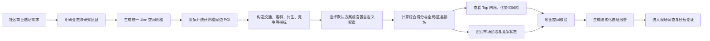
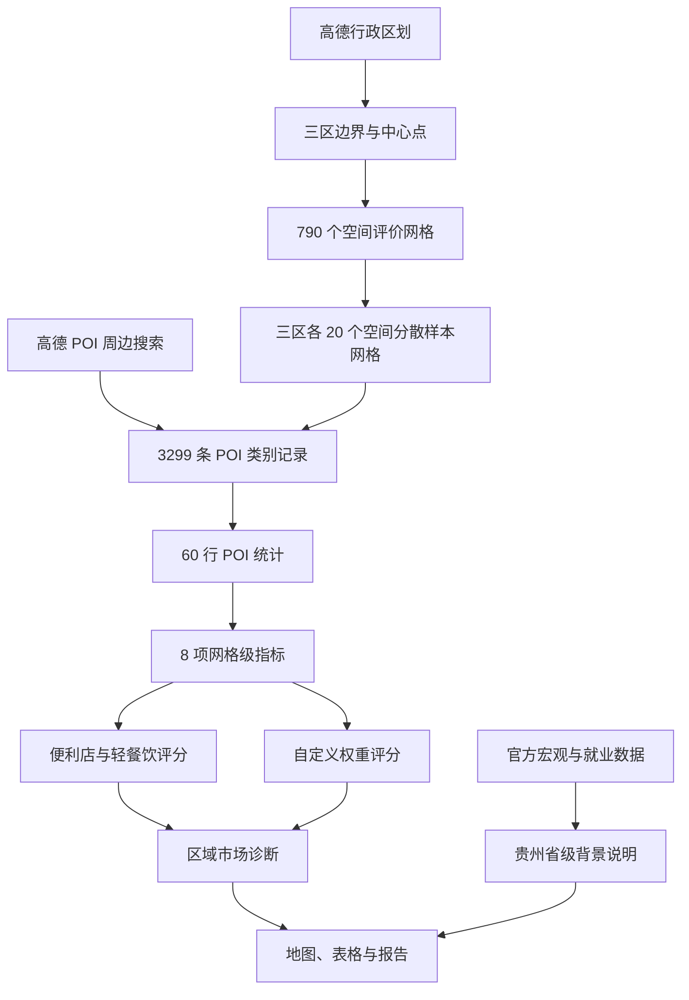
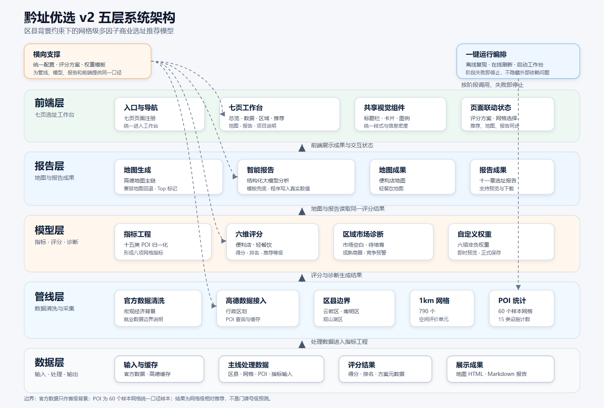
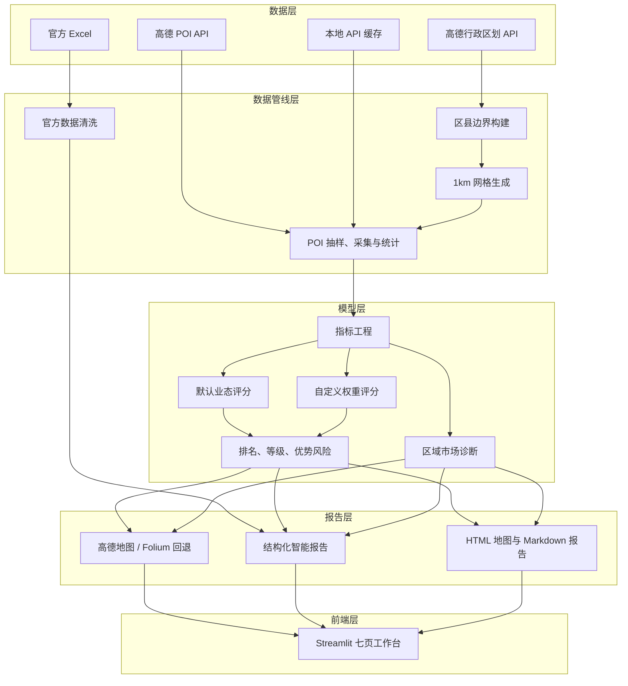

# 黔址优选 v2 项目说明材料

> 项目名称：黔址优选  
> 项目定位：贵阳市典型区县社区商业智能选址原型  
> 核心方法：区县背景约束下的网格级多因子商业选址推荐模型  
> 当前版本：v2  
> 材料日期：2026 年 6 月 14 日

## 一、项目概述

“黔址优选”是一套面向社区商业前期调研的智能选址辅助系统。项目以贵阳市云岩区、南明区和观山湖区为首版研究范围，将官方公共数据、高德行政区划、高德 POI 样本、GIS 空间网格、多因子评分、交互式地图和大模型报告组织为一条可复现的选址分析链路。

项目当前重点服务社区便利店和轻餐饮两类业态，同时提供六维非负权重自定义能力。用户可以根据不同经营策略调整交通可达性、消费潜力、就业客群代理、共生业态、竞争压力和商业氛围的相对权重，实时观察推荐结果变化。

项目不直接给出具体铺位或门牌号，也不预测真实租金、客流、营收和盈利。系统输出的是统一数据口径下的**优先考察网格、相对排名、主要优势、主要风险和经营研判材料**，用于缩小实地调研范围，提高选址比较的效率、一致性和可解释性。

### 1.1 当前已实现规模

| 项目 | 当前真实结果 |
|---|---:|
| 目标区县 | 3 个 |
| 完整空间评价网格 | 790 个 |
| 云岩区空间网格 | 136 个 |
| 南明区空间网格 | 273 个 |
| 观山湖区空间网格 | 381 个 |
| POI 样本网格 | 60 个，三区各 20 个 |
| POI 原始明细 | 3299 条类别记录 |
| POI 类别 | 15 类 |
| 有 POI 活动的评分网格 | 41 个 |
| 无 POI 活动的样本网格 | 19 个 |
| 网格级衍生指标 | 8 项 |
| 区域诊断 | 4 类市场阶段、1 类竞争预警 |
| 默认评分方案 | 社区便利店、轻餐饮 |
| 工作台页面 | 7 个 |
| 智能报告章节 | 11 章 |
| 自动化测试 | 182 项通过 |

## 二、项目背景与政策依据

### 2.1 社区商业正在成为城市生活服务的重要基础

社区商业连接居民日常消费、小微经营主体和城市公共服务，是城市商业体系中距离居民最近的一层。商务部等部门将城市一刻钟便民生活圈定义为服务半径约为步行 15 分钟、以满足居民基本消费和品质消费为目标的社区商圈，并将便利店、综合超市、早餐店等列为基本保障类业态。[^1]

2025 年，商务部等 9 部门进一步提出推动城市一刻钟便民生活圈扩围升级，到 2030 年形成“百城万圈”的建设目标，同时强调优化设施布局、丰富业态供给和提升智慧化水平。[^2]

贵阳已经具备较强的社区生活圈实践基础。贵阳市政府公开信息显示，贵阳贵安近年来围绕“老幼食住行、教业文卫体”推进便民生活圈建设，2024 年巩固提升 140 个“15 分钟生活圈”。[^3] 这为基于公共数据、位置数据和智能分析方法开展社区商业辅助决策提供了现实场景。

### 2.2 商业选址正在由经验判断走向数据辅助

传统社区门店选址通常依赖人工踩点、从业经验、零散访谈和有限竞品观察。这种方式具有直观优势，但在比较多个区域、多个业态和大量空间位置时容易出现以下问题：

1. **数据口径不统一**：不同人员、不同时间的调查方法不一致。
2. **比较范围有限**：人工难以同时覆盖数百个空间单元。
3. **业态差异表达不足**：便利店和餐饮门店对客群、交通、竞争和商业氛围的要求不同。
4. **过程难以复现**：推荐原因可能依赖个人经验，缺少结构化依据。
5. **结果解释成本高**：总分不能直接回答“为什么推荐”和“主要风险是什么”。
6. **方案调整效率低**：经营者改变业态或策略后，需要重新组织调查和判断。

《“十四五”数字经济发展规划》提出加快商贸、物流、金融等服务业数字化转型，优化管理体系和服务模式。[^4] 贵州省数字经济相关规划同样强调数字技术与实体经济融合。[^5] “黔址优选”将这一方向具体落实到社区商业选址场景：用公共数据说明区域背景，用位置数据描述周边环境，用可解释评分完成相对比较，用交互工作台和结构化报告降低使用门槛。

## 三、行业痛点与项目问题定义

### 3.1 项目解决的核心问题

本项目不试图替代经营者、规划人员和线下调查人员，而是解决一个更明确的问题：

> 在数据有限、预算有限且无法一次性完成全城精细调查的条件下，如何从贵阳市典型区县的大量空间单元中，快速筛选出更值得优先调研的网格，并给出可解释、可调整、可复现的依据？

### 3.2 项目的决策对象

项目将**1km 评价网格**作为核心决策对象，而不是直接以区县或门店地址作为最终推荐对象。

- 区县粒度过粗，难以表达同一区县内部社区、交通和商业环境差异。
- 门牌号粒度需要租金、铺面状态、客流、物业条件、经营限制等更精细数据，当前数据不支持。
- 1km 网格能够在空间差异、数据成本、结果解释和地图展示之间取得平衡。

区县在项目中承担三项作用：

1. 限定数据查询和空间网格生成范围。
2. 提供区域背景、对比和结果分组。
3. 支持用户按区县筛选推荐结果。

最终评分、排名和优势风险解释均以网格为单位。

## 四、建设目标与项目定位

### 4.1 总体目标

建设一套可运行、可解释、可调整、可复现的社区商业智能选址原型，形成“数据接入—空间建模—指标工程—业态评分—地图洞察—智能报告—交互决策”的完整闭环。

### 4.2 分项目标

1. 建立统一的目标区县、POI 类别、路径、评分模板和权重配置。
2. 获取真实区县边界与基础信息，生成稳定的 1km 空间评价网格。
3. 按统一查询半径、类别和分页规则采集 POI 样本。
4. 将离散 POI 数量转换为可比较的网格级指标。
5. 为社区便利店和轻餐饮建立差异化评分方案。
6. 支持用户自定义六维权重并即时重新计算排名。
7. 通过地图同时表达空间范围、数据覆盖状态、评分等级和 Top 网格。
8. 通过结构化大模型分析生成有证据约束的选址报告。
9. 建立默认离线复现、按需在线刷新的交付流程。
10. 保留方法边界和数据限制，避免把辅助排序包装成精确经营预测。

### 4.3 项目属性

| 维度 | 定位 |
|---|---|
| 产品属性 | 社区商业选址辅助决策原型 |
| 服务对象 | 连锁品牌、个体经营者、商业咨询人员、政府商业规划部门、园区和社区运营方 |
| 核心结果 | 优先考察网格、相对排名、指标分解、优势风险、地图和报告 |
| 当前业态 | 社区便利店、轻餐饮 |
| 扩展机制 | 自定义六维权重和两类指标模板 |
| 当前空间范围 | 云岩区、南明区、观山湖区 |
| 当前推荐粒度 | 1km 评价网格 |
| 当前数据性质 | 真实区县边界、真实 POI 样本、官方省级背景数据 |

## 五、项目核心内容

### 5.1 公共数据与位置数据融合

项目将不同数据严格限定在其能够支持的解释范围内：

| 数据层 | 数据来源 | 当前规模或范围 | 主要作用 |
|---|---|---|---|
| 官方宏观数据 | 赛事官方 Excel | 清洗后 27129 条指标记录 | 贵州省级市场背景 |
| 官方就业数据 | 赛事官方 Excel | 贵州省级汇总记录 | 就业背景和数据边界说明 |
| 行政区划 | 高德行政区划 Web 服务 | 3 个目标区县 | 区县名称、编码、中心点和边界 |
| 空间网格 | 区县边界计算生成 | 790 个 | 统一空间评价底板 |
| POI 明细 | 高德地点周边搜索 | 3299 条类别记录 | 网格周边商业、生活、交通和客群代理 |
| POI 统计 | POI 明细聚合 | 60 个样本网格 | 指标工程输入 |
| 评分结果 | 六维评分模型 | 41 个有效排名网格 | 推荐排序和解释 |

高德行政区域查询能够返回行政区名称、编码、中心点和区县边界；官方说明同时指出街道级查询不能返回边界数据。[^6] 因此本项目使用真实区县边界约束空间范围，不把街道边界设为核心依赖。

高德地点搜索 2.0 支持关键字、周边、多边形和 ID 搜索，但同一组请求参数翻页最多支持获取 200 条结果，不支持返回完整数据。[^7] 因此项目明确将 POI 定位为统一口径的原型样本，不将其描述为完整设施总量。

### 5.2 1km 空间评价底板

项目将三个区县边界统一送入米制空间计算流程：

1. 使用 `EPSG:32648` 构建米制计算空间。
2. 以 1000 米整数倍对齐格网起点。
3. 生成 1000m × 1000m 方格。
4. 将完整方格与区县边界求交。
5. 保留面积大于 0 的多边形或多多边形。
6. 按区县行政编码和稳定序号生成网格标识。
7. 计算裁剪后面积和中心点。
8. 将输出坐标数值保持为高德数据使用的 GCJ-02 表达。

边缘网格会被区县边界裁剪，因此面积可能小于 1 平方公里。完整网格与边缘网格均保留，用于真实表达区县空间范围。

### 5.3 POI 样本采集与空间抽样

当前原型没有对 790 个网格全部联网采集，而是每个区县选择 20 个空间分散网格，共 60 个样本网格。

抽样过程采用确定性空间分散策略：

1. 每区先选取最接近该区网格中心位置的网格。
2. 后续反复选择与已选集合最小距离最大的网格。
3. 距离相同时按网格标识排序。
4. 相同输入重复执行得到相同样本集合。

每个样本网格以中心点为圆心，使用 500 米周边查询半径，按 15 类 POI 分别查询。默认每类最多查询 2 页、每页 25 条；不足一页时提前停止。同一网格同一类别内按非空 POI 标识去重，不同类别之间允许交叉。

### 5.4 15 类 POI 体系

| 主题 | POI 类别 | 主要解释 |
|---|---|---|
| 社区零售 | 便利店、超市 | 日常零售供给、潜在竞品和生活消费 |
| 餐饮消费 | 餐饮、快餐、小吃、咖啡、茶饮 | 餐饮需求、消费氛围和竞品 |
| 生活客群 | 学校、医院、小区 | 居住、学生、陪护和日常服务客群代理 |
| 商业办公 | 商场、写字楼 | 商业集聚和办公客群代理 |
| 交通配套 | 公交站、地铁站、停车场 | 公共交通与到达便利性代理 |

POI 类别计数可能发生交叉。例如，一个地点可能同时被餐饮大类和某个餐饮细分类召回。因此 15 类计数之和不等于跨类别去重后的唯一设施数量。

## 六、项目总体逻辑

### 6.1 业务逻辑



### 6.2 数据逻辑



### 6.3 决策逻辑

项目将决策过程拆为五个层次：

1. **范围层**：区县边界定义研究范围。
2. **空间层**：1km 网格定义统一比较对象。
3. **证据层**：POI 类别描述网格周边可观察环境。
4. **模型层**：六维权重表达不同业态或经营策略。
5. **解释层**：排名、指标、地图和报告共同支持人工研判。

这种结构避免把区县背景、空间证据、模型偏好和最终解释混为一体。

## 七、指标体系与特征工程

### 7.1 POI 计数归一化

不同 POI 类别的数量级差异明显。项目先对每个 POI 计数字段执行：

$$
y_{ij} = \ln(1 + x_{ij})
$$

其中，$x_{ij}$ 表示网格 $i$ 在 POI 类别 $j$ 下的计数。`log1p` 可以压缩大计数对结果的支配作用，同时保留零值。NumPy 官方将 `log1p` 定义为逐元素计算 $\log(1+x)$。[^8]

随后在全部 60 个样本网格范围内执行全局 Min-Max 归一化：

$$
z_{ij} =
\frac{y_{ij}-\min(y_j)}
{\max(y_j)-\min(y_j)}
\times 100
$$

Min-Max 方法将每个字段线性缩放到指定区间。[^9] 若某个字段在全部样本网格中为常量，则统一记为 0，表示该字段无法区分网格。

项目不按区县分别归一化，目的是保持三个区县网格之间的可比性。

### 7.2 八项网格级指标

复合指标采用组成字段归一化结果的等权平均。

| 指标字段 | 中文含义 | 组成 POI |
|---|---|---|
| `traffic_accessibility` | 交通可达性 | 公交站、地铁站、停车场 |
| `consumption_potential` | 消费潜力 | 小区、超市、商场、学校、医院 |
| `employment_customer_proxy` | 就业/办公客群代理 | 写字楼、商场、学校、餐饮 |
| `business_atmosphere` | 商业氛围 | 商场、餐饮、咖啡、茶饮、超市 |
| `convenience_synergy_score` | 便利店共生业态 | 小区、学校、医院、公交站、超市 |
| `light_food_synergy_score` | 轻餐饮共生业态 | 写字楼、学校、商场、公交站、咖啡、茶饮 |
| `convenience_competition_pressure` | 便利店竞争压力 | 便利店、超市 |
| `light_food_competition_pressure` | 轻餐饮竞争压力 | 餐饮、快餐、小吃、咖啡、茶饮 |

其中，“就业/办公客群代理”是由周边 POI 结构形成的空间代理指标，不代表真实就业人口或就业密度。

### 7.3 审计字段

每个评分网格同时保留三个审计字段：

- `poi_total_count`：15 类计数之和，不代表唯一 POI 数。
- `poi_category_coverage`：非零 POI 类别数量，范围为 0 至 15。
- `has_poi_activity`：是否至少存在一类非零 POI。

19 个无 POI 活动网格仍保留在评分结果中，但综合得分固定为 0、排名留空，不会因为竞争压力低而获得虚假推荐优势。

## 八、评分模型

### 8.1 六维通用评分框架

每个评分方案包含六项权重：

1. 交通可达性。
2. 消费潜力。
3. 就业/办公客群代理。
4. 共生业态。
5. 低竞争得分。
6. 商业氛围。

竞争压力是负向指标，进入综合评分前转换为：

$$
C_i = 100 - P_i
$$

其中，$P_i$ 为业态对应的竞争压力，$C_i$ 为低竞争得分。

综合得分为：

$$
S_i =
w_tT_i+
w_cC^{pot}_i+
w_eE_i+
w_sY_i+
w_pC_i+
w_bB_i
$$

并满足：

$$
w_t+w_c+w_e+w_s+w_p+w_b=1,\qquad w_k\geq0
$$

### 8.2 默认社区便利店方案

| 维度 | 权重 |
|---|---:|
| 交通可达性 | 20% |
| 消费潜力 | 25% |
| 就业/办公客群代理 | 10% |
| 便利店共生业态 | 20% |
| 低竞争得分 | 15% |
| 商业氛围 | 10% |

该方案更重视社区生活需求、稳定消费场景和周边共生设施。

### 8.3 默认轻餐饮方案

| 维度 | 权重 |
|---|---:|
| 交通可达性 | 15% |
| 消费潜力 | 10% |
| 就业/办公客群代理 | 25% |
| 轻餐饮共生业态 | 20% |
| 低竞争得分 | 15% |
| 商业氛围 | 15% |

该方案提高就业/办公客群代理和商业氛围的权重，用于表达工作日消费、办公客流和餐饮聚集环境的重要性。

默认权重属于比赛原型的业务经验设定，不是使用真实门店经营结果训练得到的参数。

### 8.4 自定义权重

前端提供“100 分权重预算器”，允许用户输入六项非负百分比：

- 合计为 100% 时直接进入评分。
- 合计不为 100% 时可使用确定性归一进行即时预览。
- 六项全部为 0 时禁止计算。
- 正式保存要求输入权重精确合计为 100.00%。

自定义方案必须明确选择“社区零售型”或“餐饮服务型”指标模板。模板决定共生和竞争指标，权重决定六个维度的相对贡献。该机制能够适配不同经营策略，但不能替代新增业态所需的专属数据建设。

### 8.5 排名与推荐等级

仅 41 个有 POI 活动的网格参与排名。排序规则依次为：

1. 未四舍五入综合得分降序。
2. POI 类别计数总和降序。
3. 网格标识升序。

每个方案分别生成全局排名和区县排名。

推荐等级按有效排名网格划分：

| 范围 | 推荐等级 | 当前数量 |
|---|---|---:|
| 前 20%，向上取整 | 推荐 | 9 |
| 前 60%以内且不属于前 20% | 谨慎推荐 | 16 |
| 其余有效排名网格 | 暂不推荐 | 16 |
| 无 POI 活动 | 不参与排名 | 19 |

### 8.6 优势与风险解释

系统不只输出综合得分，还对六个正向维度进行比较：

- 主要优势取表现最高的正向维度。
- 主要风险比较正向指标缺口和原始竞争压力。
- 无 POI 活动网格固定提示“缺少可用于推荐的 POI 活动”。

这使评分结果能够回答“为什么靠前”“哪项指标较弱”“竞争风险是否突出”等问题。

### 8.7 区域市场诊断

区域市场诊断复用现有指标，不增加新的外部数据，也不改变六维综合得分。系统只使用全市 41 个有 POI 活动网格计算 P33 和 P67，将每项指标划分为低位、适中和高位；若两个阈值相等，则小于临界值为低位、等于临界值为适中、大于临界值为高位。

需求客群代理定义为：

$$
D_i = \frac{C^{pot}_i + E_i}{2}
$$

其中，$C^{pot}_i$ 为消费潜力，$E_i$ 为就业/办公客群代理。该指标只用于样本网格相对分层，不是真实客流。

市场阶段规则如下：

| 市场阶段 | 相对条件 |
|---|---|
| 市场空白型 | 消费潜力高、共生业态高、商业氛围适中、竞争压力未达到高位 |
| 待培育型 | 竞争压力低、商业氛围低、共生业态低 |
| 成熟商圈型 | 商业氛围高、共生业态高、竞争压力高 |
| 一般观察型 | 其余有 POI 活动网格 |

竞争状态独立判断。当商业氛围、需求客群代理和竞争压力均处于高位时，标记为“过度竞争预警”。成熟商圈型与过度竞争预警可以同时成立，因为前者描述市场阶段，后者提示竞争风险。

当前真实结果为：

| 方案 | 市场空白型 | 待培育型 | 成熟商圈型 | 一般观察型 | 过度竞争预警 |
|---|---:|---:|---:|---:|---:|
| 社区便利店 | 1 | 12 | 12 | 16 | 12 |
| 轻餐饮 | 1 | 9 | 12 | 19 | 13 |

两类方案的市场空白网格均为 `grid_520103_000046`。这些标签只描述当前样本中的相对位置：市场空白不等于保证盈利，过度竞争预警不代表企业真实经营状况。无 POI 活动网格不参与阈值计算和诊断。

## 九、系统技术架构

### 9.1 总体架构

当前 v2 主线五层架构如下：





五层职责可以概括为：

| 层级 | 当前职责 | 对应位置 |
|---|---|---|
| 数据层 | 保存官方数据、高德缓存、处理数据、评分结果、地图和报告输出 | `data/`、`outputs/` |
| 管线层 | 将官方 Excel、高德区县边界和 POI 样本转为主线处理数据 | `src/pipeline/` |
| 模型层 | 执行指标工程、六维评分、自定义权重和区域市场诊断 | `src/modeling/` |
| 报告层 | 生成地图 HTML、结构化 DeepSeek 报告和规则模板报告 | `src/presentation/` |
| 前端层 | 提供七页 Streamlit 工作台、跨页面选择和统一视觉组件 | `src/app.py`、`src/web/` |

`src/core/` 和 `config.yaml` 为横向支撑，向管线层、模型层、报告层和前端层提供统一路径、配置和评分方案目录。

### 9.2 源码职责划分

| 包 | 主要职责 |
|---|---|
| `src/core/` | 配置读取、路径解析、评分方案目录 |
| `src/pipeline/` | 高德客户端、区县、网格、POI 数据管线 |
| `src/pipeline/official/` | 官方 Excel 清洗和背景报告 |
| `src/modeling/` | 指标工程、评分、自定义权重、区域市场诊断 |
| `src/presentation/` | 地图和智能报告 |
| `src/web/decision_context.py` | 网格推荐、地图洞察和智能报告共享的方案与网格选择 |
| `src/web/pages/` | 七个工作台页面 |
| `src/web/ui/` | 统一视觉组件和主题 |
| `src/legacy/v1/` | 独立保存的旧版 OSM/GIS 实现 |

当前主线与 v1 在源码、配置、数据、输出、测试和文档上均已隔离。当前入口不会导入旧版业务包。

## 十、核心技术

### 10.1 高德行政区划与请求缓存

高德客户端统一封装区县查询、周边 POI 查询和多边形 POI 查询。请求参数经过稳定序列化后生成缓存键，相同请求优先读取本地 JSON 缓存，以降低重复请求、网络波动和接口配额对演示的影响。

API 密钥只从环境变量读取，不写入源码、配置、日志和文档。

### 10.2 GIS 网格生成与边界裁剪

项目使用 GeoPandas 和 Shapely 完成：

- 区县边界读取。
- 米制投影。
- 统一格网轴线。
- 方格与边界求交。
- Polygon、MultiPolygon 处理。
- 裁剪面积与中心点计算。
- CSV、WKT 和 GeoJSON 输出。

稳定的网格轴线和编号规则保证相同边界、相同配置重复运行时得到一致结果。

### 10.3 空间分散抽样

通过确定性最远点抽样，在有限 API 调用预算下覆盖区县内部不同位置。该方法比连续选择中心城区高密度网格更能表达空间差异，同时保留重复执行一致性。

### 10.4 可解释指标工程

项目没有直接用黑盒模型从 POI 计数生成结果，而是保留以下可审计链路：

```text
原始 POI 明细
→ 15 类计数
→ 单字段 log1p
→ 全局 0-100 归一化
→ 组成字段等权平均
→ 8 项网格指标
→ 六维业态评分
```

任何综合得分都可以追溯到原始类别计数、指标组成和权重。

### 10.5 高德 JS API 同源地图

地图主链使用高德地图 JS API 2.0，直接展示当前 GCJ-02 网格、边界和中心点。高德 JS API 支持多边形等地图覆盖物管理。[^10]

地图对 790 个空间网格进行四类状态表达：

1. 未采集网格。
2. 已采集但无 POI 活动的网格。
3. 有效评分网格。
4. 全局 Top 10 编号网格。

有评分网格按固定色阶展示；悬停显示摘要，点击显示推荐等级、六维指标、优势和风险。缺少高德 JS 凭据时，系统使用 Folium 兼容地图，且仅在兼容路径进行显示坐标转换。

市场阶段、竞争状态和诊断摘要进入悬停与点击详情，但不改变评分色阶和 Top 10 标记。

### 10.6 Streamlit 多页工作台

工作台使用 `st.Page` 和 `st.navigation` 组织七页结构。Streamlit 官方将 `st.navigation` 定义为入口脚本中的多页路由机制，当前页通过返回对象的 `.run()` 执行。[^11]

项目使用 Altair 构建区县 POI 主题图、评分对比和六维指标图。页面读取同一套评分结果和方案目录，避免地图、推荐表和报告使用不同评分逻辑。

### 10.7 结构化 DeepSeek 报告

智能报告不是让模型直接自由生成完整结论，而是采用：

```text
真实评分记录
→ 构造结构化输入和证据白名单
→ DeepSeek 输出分析 JSON
→ Python 校验证据、方向、章节和内容
→ Python 写入真实数值
→ 渲染固定 11 章 Markdown
```

DeepSeek 官方 JSON Output 能够约束模型返回有效 JSON，官方同时提示偶尔可能返回空内容，因此项目对空响应只在同一模型上进行一次重试。[^12]

项目默认使用 `deepseek-v4-pro` 非思考模式；官方 API 支持通过 `thinking.type` 在思考与非思考模式间切换。[^13] 仅当连接、超时、限流、服务端错误或模型不可用时，系统才调用一次 `deepseek-v4-flash`。鉴权、余额、参数和输入数据错误不会通过切换模型掩盖。

模型输出必须满足：

- 11 个章节键完整。
- 每章使用允许的证据字段。
- 不自行写入评分、排名、权重和坐标数值。
- 不扩展为路网密度、真实人口、租金、客流等未接入数据。
- 竞争压力与低竞争得分方向正确。
- 只能解释程序生成的市场阶段和竞争状态，不得自行修改诊断标签。
- 需求客群代理不得解释为真实客流。
- 经营建议包含可核验依据。

### 10.8 原子输出与失败回滚

指标、评分、元数据、地图和报告的重要输出先写入临时文件，在全部生成成功后再替换正式文件。多文件输出过程中发生异常时，恢复原有完整结果，避免产生一部分新文件和一部分旧文件的混合状态。

### 10.9 一键运行与离线复现

默认命令：

```powershell
python scripts/run_pipeline.py
```

默认流程不调用外部 API，依次执行：

1. 校验区县、边界、网格和 POI 样本输入。
2. 重建网格级指标。
3. 生成两类默认评分。
4. 生成两张地图。
5. 生成两类 Top 1 规则模板报告。
6. 验收数据规模和输出。
7. 写出运行摘要。

在线刷新、DeepSeek 报告和 Streamlit 服务必须通过显式参数启用。端口被占用时不会自动启动第二个服务实例。

## 十一、工作台功能体系

### 11.1 项目总览

- 展示 3 个区县、790 个空间网格、15 类 POI 和 41 个活跃评分网格。
- 将 15 类 POI 汇总为社区零售、餐饮消费、生活客群、商业办公和交通配套五类主题。
- 对比三区便利店与轻餐饮活跃网格平均分。
- 明示相对评价和现场核验边界。

### 11.2 数据底座

- 展示当前真实数据文件、记录数、地域范围和用途。
- 区分省级背景数据、空间底板、POI 样本和评分输入。
- 不显示本机绝对路径和敏感凭据。

### 11.3 区域对比

- 展示三区网格数量、活跃网格数量、POI 计数总和、平均分和最高分网格。
- 展示便利店与餐饮、客群与商业设施、交通设施三组原始数量对比。
- 区县对比只用于背景画像，不替代网格级推荐。

### 11.4 网格推荐

- 支持默认社区便利店、默认轻餐饮、已保存方案和新建自定义方案。
- 支持全部区县或单一区县筛选。
- 展示全局 Top 10 或区县 Top 5。
- 展示综合得分、排名、推荐等级、主要优势和主要风险。
- 展示市场阶段分布、过度竞争预警数量，并支持两类诊断筛选。
- 展示选中网格六维指标分解。
- 支持权重即时预览和正式保存。

### 11.5 地图洞察

- 展示全部 790 个空间网格。
- 区分未采集、无活动、有效评分和 Top 10。
- 支持方案切换。
- 支持高德主链与 Folium 兼容地图。
- 支持悬停摘要和点击详情。
- 诊断标签进入详情，但不改变地图评分颜色。

### 11.6 智能报告

- 仅列出有 POI 活动且有有效排名的网格。
- 点击按钮后才调用 DeepSeek。
- 显示报告生成中、生成完成或失败状态。
- 会话内缓存同一方案与网格结果，避免页面刷新重复调用。
- API 不可用时明确显示错误，并允许用户主动选择规则模板报告。
- 支持 Markdown 预览和下载。
- 固定 11 章中引用程序生成的市场阶段、竞争状态和诊断摘要。

### 11.7 项目说明

- 说明当前已实现能力。
- 说明官方数据、POI 样本和评分结果的解释边界。
- 说明系统不提供的能力和线下核验要求。

## 十二、项目创新点

### 12.1 从行政区排序转向网格级决策

项目不使用少量区县平均值直接代替选址判断，而是让区县承担背景约束作用，将最终比较对象下沉到 1km 网格，更好表达区县内部空间差异。

### 12.2 数据职责分层，而非强行下钻

官方宏观和就业数据只用于贵州省级背景说明，不被机械拆分成网格数据。POI 负责描述可观察空间环境，模型负责相对评分。该做法牺牲了表面上的数据丰富度，但提高了结论的真实性和边界清晰度。

### 12.3 业态模板与权重参数分离

指标模板决定“用什么共生和竞争证据”，权重决定“不同证据有多重要”。便利店和轻餐饮共享通用六维框架，又保留各自的共生与竞争字段。用户可以调整策略，而不需要复制另一套模型代码。

### 12.4 数据覆盖状态进入地图表达

地图不把未采集网格填成零分，也不把无 POI 活动网格与未采集网格混为一体。通过显式状态区分，用户能够同时看到推荐结果和数据覆盖范围。

### 12.5 大模型只负责受约束分析

模型不直接控制评分，不自行生成项目数值。程序通过证据白名单、JSON 结构、内容校验和事实回填控制报告质量，降低无依据扩展、方向错误和数值幻觉风险。

### 12.6 相对质量优先的工程策略

在无法获得完整客流、租金和经营数据时，项目不追求无法验证的绝对精度，而是优先保证：

- 查询口径一致。
- 抽样过程稳定。
- 指标构造透明。
- 排名过程可复现。
- 结果边界明确。
- 错误和缺失不被包装成成功。

### 12.7 主线与历史实现可运行隔离

v2 按职责组织为数据管线、模型、展示和 Web 层；v1 的 OSM/GIS 实现保留在独立目录中，可用于历史追溯和旧结果复现，但不会污染当前配置和入口。

### 12.8 从推荐排序扩展到区域诊断

项目在不引入额外 API 和不改变评分公式的条件下，将已有指标重新组织为市场阶段与竞争状态。用户不仅能看到“哪些网格排名靠前”，还可以识别相对市场空白、待培育区域、成熟商圈和过度竞争风险，从单一 Top 排名扩展为区域结构研判。

## 十三、应用场景

### 13.1 连锁便利店拓店初筛

连锁品牌可先使用默认社区便利店方案，对目标区县进行网格排序，再结合租金、铺面面积、加盟政策和现场客流进行二次筛选。

### 13.2 轻餐饮门店布局

轻餐饮经营者可重点观察就业/办公客群代理、餐饮共生业态、商业氛围和竞争压力，筛选适合午餐、下午茶或工作日消费场景的网格。

### 13.3 自定义社区业态分析

社区零售型或餐饮服务型经营者可以根据自身策略设置六项权重。例如：

- 通勤导向门店提高交通可达性权重。
- 社区刚需门店提高消费潜力和社区共生权重。
- 差异化门店提高低竞争得分权重。
- 商业综合体周边门店提高商业氛围权重。

### 13.4 政府便民生活圈规划参考

政府商业主管部门、街道和社区运营方可将结果用于观察商业设施分布、识别服务相对薄弱区域、比较区县背景和形成补充调研清单。系统结果不能单独作为规划审批或资源配置依据。

### 13.5 园区与商业载体招商

产业园区、商业街区、社区商业中心和物业运营方可根据周边 POI、交通和客群代理，为便利零售、餐饮服务等业态制定初步招商方向。

### 13.6 商业咨询和教学演示

项目保留了从原始数据到评分结果的完整审计链路，可用于商业分析课程、GIS 实践、数据产品设计和大模型受约束生成案例。

## 十四、用户价值

| 用户 | 主要价值 |
|---|---|
| 连锁品牌拓展人员 | 快速缩小调研范围，统一多区域比较口径 |
| 个体经营者 | 用可解释指标辅助经验判断 |
| 商业咨询人员 | 快速生成结构化比较、地图和报告 |
| 政府商业主管部门 | 辅助观察社区商业空间差异和设施结构 |
| 园区、社区和物业运营方 | 支持招商业态初筛和配套分析 |
| 技术与教学团队 | 提供可复现的公共数据、GIS、评分和大模型工程案例 |

## 十五、当前结果与验证

### 15.1 数据结果

- 三区完整空间网格：790 个。
- POI 样本网格：60 个。
- 有 POI 活动网格：41 个。
- 无 POI 活动网格：19 个。
- POI 类别记录：3299 条。
- 云岩区、南明区、观山湖区活跃网格分别为 17、13、11 个。

### 15.2 区县样本结果

| 区县 | 样本网格 | 活跃网格 | POI 类别计数总和 | 便利店平均分 | 轻餐饮平均分 |
|---|---:|---:|---:|---:|---:|
| 云岩区 | 20 | 17 | 1975 | 37.14 | 34.07 |
| 南明区 | 20 | 13 | 1000 | 31.13 | 28.72 |
| 观山湖区 | 20 | 11 | 324 | 21.96 | 21.28 |

这些数值只描述当前 60 个样本网格，不代表区县完整设施总量，也不等同于区县商业价值结论。

### 15.3 默认方案示例

当前两个默认方案的全局排名第 1 网格均为：

```text
grid_520103_000078
所属区县：云岩区
社区便利店得分：83.03
轻餐饮得分：84.44
```

该结果说明当前样本和权重下，该网格在两类方案中均表现突出；不能直接推导为具体铺位必然成功。

### 15.4 工程验证

- 182 项自动化测试通过。
- 当前默认离线流水线可完整重建指标、评分、地图和模板报告。
- v1 与 v2 结构边界测试通过。
- 评分结果保持 60 行、三区各 20 行。
- 两类默认方案均为 41 个有效排名和 19 个空排名。
- 社区便利店诊断为市场空白 1、待培育 12、成熟商圈 12、一般观察 16、过度竞争预警 12。
- 轻餐饮诊断为市场空白 1、待培育 9、成熟商圈 12、一般观察 19、过度竞争预警 13。
- 两类市场空白网格均为 `grid_520103_000046`。
- 两张地图均可生成并展示 790 个网格状态。
- 两类 Top 1 报告均包含固定 11 章。
- 七页 Streamlit 工作台已完成浏览器验收。
- 高德缓存文件保留在本机，不纳入 Git。

## 十六、可复制推广路径

### 16.1 空间范围扩展

短期可扩展至花溪区和白云区；中期可覆盖贵阳市更多区县；长期可将配置、行政编码和数据源替换为其他城市。

### 16.2 样本范围扩展

当前为每区 20 个网格。若 API 配额、运行时间和人工核验能力允许，可逐步扩展到全部空间网格，并保留现有缓存、失败停止和数据质量报告机制。

### 16.3 业态扩展

新增银行网点、药店、生鲜零售、养老服务、托育服务等正式业态时，需要：

1. 补充专属 POI 类别或其他业务数据。
2. 重新定义共生业态和竞争压力。
3. 明确业务目标和权重依据。
4. 通过测试和样本案例验证结果。

不能只修改方案名称就宣称完成新业态模型。

### 16.4 数据扩展

可在获得合法授权和稳定口径后接入：

- 商铺租金和空置状态。
- 匿名化客流或热力数据。
- 人口和居住结构。
- 道路步行网络和真实到达时间。
- 门店经营流水和存续结果。
- 商圈活动、外卖订单和消费评价。
- 土地利用和规划约束。

### 16.5 模型扩展

当具备真实门店标签和经营结果后，可开展：

- 权重校准。
- 排序学习。
- 生存分析。
- 门店成功概率建模。
- 多业态组合布局。
- Location-Allocation 优化。
- 时序变化和敏感性分析。

## 十七、风险、限制与改进方向

### 17.1 POI 样本限制

- 当前只采集 60 个网格。
- 关键词搜索可能低估或扩大部分类型召回。
- POI 分类之间可能交叉。
- 接口结果受更新时间、分页和搜索排序影响。
- 零结果不必然表示现实中不存在相关设施。

改进方向是扩大抽样、增加分批核验、保存采集时间、开展关键词与分类编码敏感性分析，并在条件允许时引入多源交叉验证。

### 17.2 指标代理限制

学校、写字楼、商场、小区等 POI 只能作为客群和场景代理，不能替代真实人口、就业、消费和客流数据。

### 17.3 空间尺度限制

1km 网格适合前期筛选，但可能跨越道路、河流、山体或不同社区边界。当前 500 米圆形查询也不等同于真实步行可达范围。

后续可基于道路网络、步行时间或 H3 六边形建立更精细空间单元。

### 17.4 坐标处理限制

高德数据使用 GCJ-02。项目地图主链直接使用高德 JS API 保持同源展示；米制网格计算使用工程化投影处理，不宣称完成 GCJ-02 与 WGS84 的严格测绘级转换。

### 17.5 权重依据限制

默认权重来自业务经验和比赛原型设计，不是由真实经营成败样本训练。用户自定义权重提高了适配能力，但也可能引入主观偏好。

### 17.6 报告模型限制

结构化输出和证据校验能够降低无依据内容，但不能完全消除语言模型错误。报告用于辅助阅读，事实数值仍以程序输出和源数据为准。

### 17.7 经营决策限制

最终开店还需核验：

- 铺面租金与转让成本。
- 门店可见性、出入口和停车条件。
- 真实人流和时段分布。
- 物业、消防、环保和经营许可。
- 供应链和配送半径。
- 周边在建项目和未来规划。
- 竞品经营质量和价格带。

## 十八、项目运行与交付

### 18.1 默认离线复现

```powershell
python scripts/run_pipeline.py
```

### 18.2 启动工作台

```powershell
streamlit run src/app.py
```

### 18.3 可选在线能力

```powershell
# 重新处理官方 Excel
python scripts/run_pipeline.py --refresh-official

# 在线刷新高德区县、网格和 POI 样本
python scripts/run_pipeline.py --refresh-amap

# 使用 DeepSeek 生成报告
python scripts/run_pipeline.py --with-llm

# 验收后启动唯一的 8501 服务
python scripts/run_pipeline.py --serve
```

### 18.4 主要交付物

1. 目标区县基础信息与边界。
2. 790 个空间网格 CSV 和 GeoJSON。
3. POI 原始明细与网格统计。
4. 网格评分输入。
5. 两类默认评分与区县汇总。
6. 自定义评分方案结果。
7. 两张默认地图 HTML。
8. 结构化选址报告 Markdown。
9. 七页 Streamlit 工作台。
10. 一键运行摘要、测试和项目文档。

### 18.5 安全与凭据

项目涉及四项环境变量：

- `AMAP_KEY`：高德行政区划和 POI Web 服务。
- `AMAP_JS_KEY`：高德地图 JS API。
- `AMAP_JS_SECURITY_CODE`：高德地图 JS API 安全密钥。
- `DEEPSEEK_API_KEY`：智能报告。

凭据不进入项目配置、源码和 Git。地图导出 HTML 中浏览器凭据可能对使用者可见，因此只用于本机演示或受控交付；公开部署应采用高德官方推荐的安全方案。

### 18.6 Step 18 之后的维护边界

Step 18 是当前执行计划终点。后续工作按维护、核验或另行批准的增强任务处理，不自动形成 Step 19。本文后续“十九、项目价值总结”和“二十、附录”是说明材料章节，不是新的实现步骤。

后续功能继续进入现有 `src/core/`、`src/pipeline/`、`src/modeling/`、`src/presentation/` 和 `src/web/` 职责包。空间扩展、样本扩展、新业态、新数据和新模型仍属于路线设想，只有完成真实数据接入、实现和验证后，才能写入当前能力。

## 十九、项目价值总结

“黔址优选”v2 的核心价值不在于给出一个无法验证的“最佳门店地址”，而在于建立了一套边界清晰的社区商业选址辅助方法：

1. 用官方公共数据说明区域背景。
2. 用高德边界建立统一研究范围。
3. 用 1km 网格承载空间比较。
4. 用 POI 样本构造可解释指标。
5. 用差异化权重表达不同业态策略。
6. 用排名、地图和报告形成多层解释。
7. 用自定义权重支持用户参与决策。
8. 用自动化测试、缓存、原子输出和一键运行保证工程可复现。
9. 用明确限制避免把样本评价扩展为盈利承诺。

该项目已经形成从数据、模型到交互和报告的完整原型，可用于比赛展示、商业调研、社区商业规划参考和后续产品化验证。

## 二十、附录

### 附录 A：关键术语

| 术语 | 说明 |
|---|---|
| 评价网格 | 在目标区县边界内生成并裁剪的约 1km 空间单元 |
| POI | 地图中的兴趣点或设施地点 |
| 活跃网格 | 至少有一个 POI 类别计数大于 0 的样本网格 |
| 共生业态 | 能为目标业态提供客群、场景或消费协同的周边设施 |
| 竞争压力 | 与目标业态直接或间接竞争的周边设施强度 |
| 低竞争得分 | `100 - 竞争压力` |
| 就业客群代理 | 由写字楼、商场、学校、餐饮等 POI 构造的空间代理指标 |
| 自定义方案 | 用户选择指标模板并设置六维权重后形成的评分方案 |

### 附录 B：当前 POI 类别计数总和

下表是 60 个样本网格中各类别计数之和，类别之间可能交叉。

| POI 类别 | 计数 |
|---|---:|
| 超市 | 601 |
| 小吃 | 484 |
| 快餐 | 481 |
| 便利店 | 375 |
| 停车场 | 307 |
| 小区 | 294 |
| 咖啡 | 147 |
| 公交站 | 140 |
| 写字楼 | 128 |
| 学校 | 117 |
| 茶饮 | 85 |
| 餐饮 | 66 |
| 商场 | 43 |
| 医院 | 26 |
| 地铁站 | 5 |

### 附录 C：项目内参考文档

- [README](../README.md)
- [方法调整说明](方法调整说明.md)
- [初赛方案](初赛方案_新版.md)
- [技术路线草图](技术路线草图.md)
- [推荐项目方案](推荐项目方案.md)
- [项目结构说明](项目结构说明.md)
- [最终交付清单](最终交付清单.md)
- [五分钟演示脚本](5分钟演示脚本.md)
- [v2 总控文档](../黔址优选_Codex多步执行指令.md)

### 附录 D：外部参考资料

[^1]: 商务部办公厅等 11 部门：《[城市一刻钟便民生活圈建设指南](https://www.mofcom.gov.cn/zwgk/gztz/art/2021/art_04807f8fe711403485c7d962a83a1172.html)》，2021 年 7 月 20 日。
[^2]: 商务部等 9 部门：《[关于加力推动城市一刻钟便民生活圈建设扩围升级的通知](https://www.mofcom.gov.cn/zwgk/gztz/art/2025/art_3cfd51aa4bd445ecbc0422c139679f4e.html)》，2025 年。
[^3]: 贵阳市人民政府：《[城市品质“蝶变” 幸福生活“加码”——贵阳贵安推进以人为核心的新型城镇化综述](https://www.guiyang.gov.cn/ztzl/rdzt/qshgygazxd_5868562/gztj/xxczh/202501/t20250104_86578340.html)》，2025 年 1 月 4 日。
[^4]: 国务院：《[“十四五”数字经济发展规划](https://www.gov.cn/zhengce/content/2022-01/12/content_5667817.htm)》，2022 年 1 月 12 日。
[^5]: 贵州省大数据发展管理局：《[省大数据发展领导小组办公室关于印发贵州省“十四五”数字经济发展规划的通知](https://dsj.guizhou.gov.cn/zwgk/ghjh/202112/t20211230_86420344.html)》，2021 年 12 月 30 日。
[^6]: 高德开放平台：《[行政区域查询](https://lbs.amap.com/api/webservice/guide/api/district)》，最后更新时间 2024 年 10 月 24 日。
[^7]: 高德开放平台：《[搜索 POI 2.0](https://lbs.amap.com/api/webservice/guide/api-advanced/newpoisearch)》，检索日期 2026 年 6 月 14 日。
[^8]: NumPy：《[numpy.log1p](https://numpy.org/doc/2.0/reference/generated/numpy.log1p.html)》。
[^9]: scikit-learn：《[MinMaxScaler](https://scikit-learn.org/stable/modules/generated/sklearn.preprocessing.MinMaxScaler.html)》。
[^10]: 高德开放平台：《[地图 JS API 2.0 覆盖物与图层管理](https://lbs.amap.com/api/javascript-api-v2/guide/map/map-layer)》。
[^11]: Streamlit：《[st.navigation](https://docs.streamlit.io/develop/api-reference/navigation/st.navigation)》。
[^12]: DeepSeek：《[JSON Output](https://api-docs.deepseek.com/guides/json_mode)》。
[^13]: DeepSeek：《[Thinking Mode](https://api-docs.deepseek.com/guides/thinking_mode)》。
